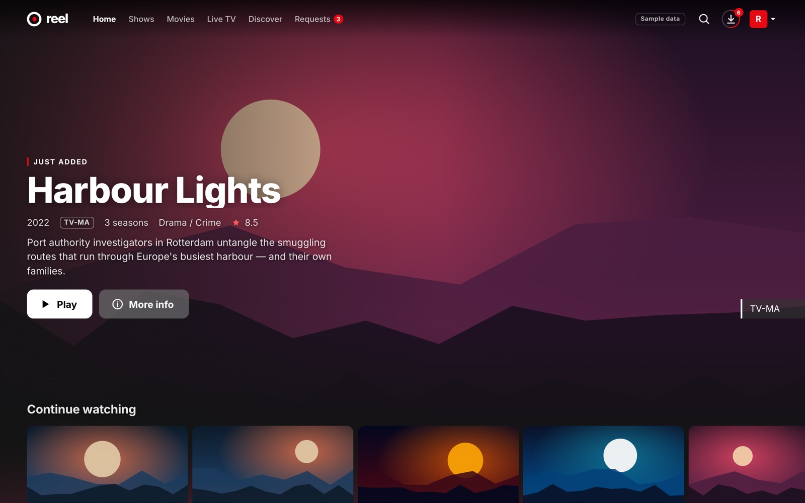
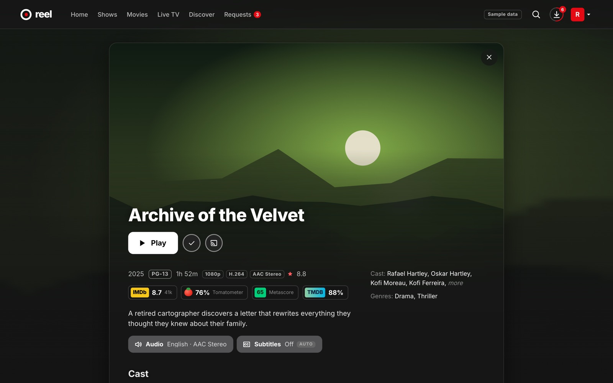
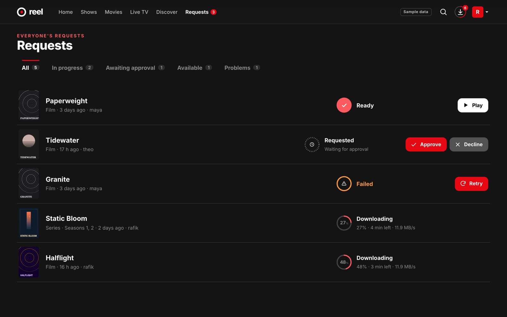
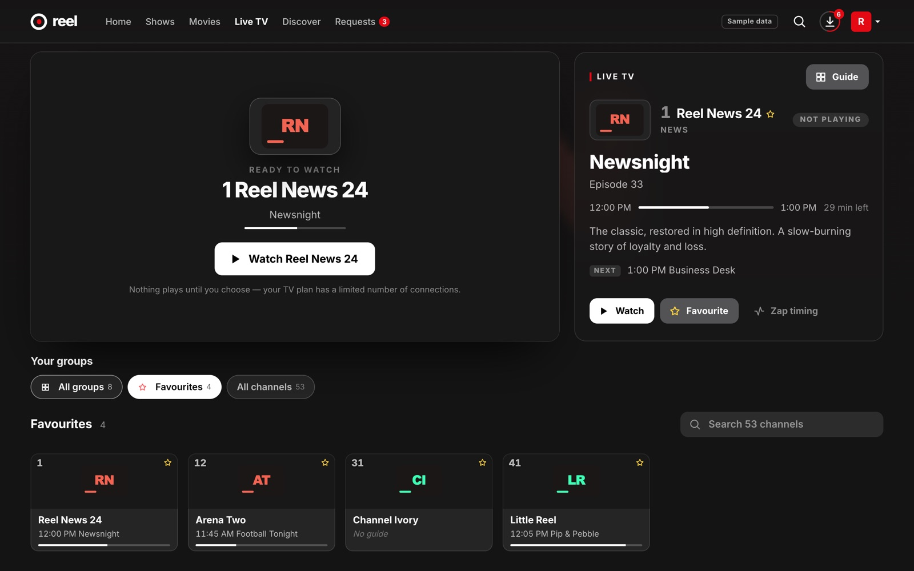
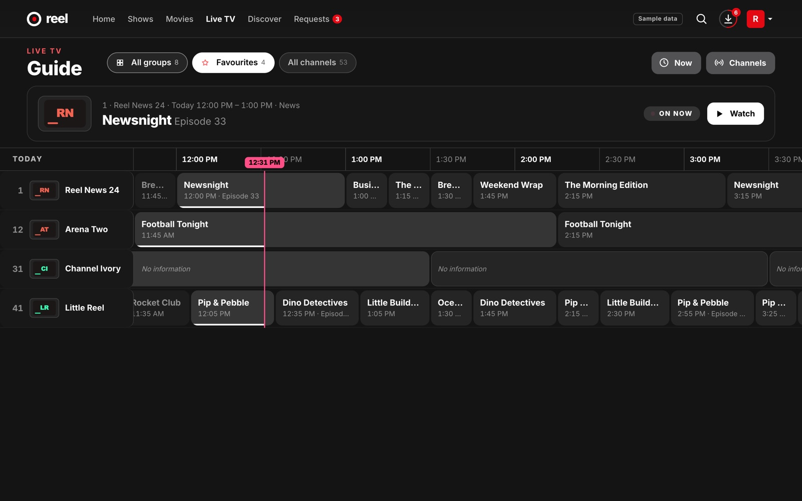
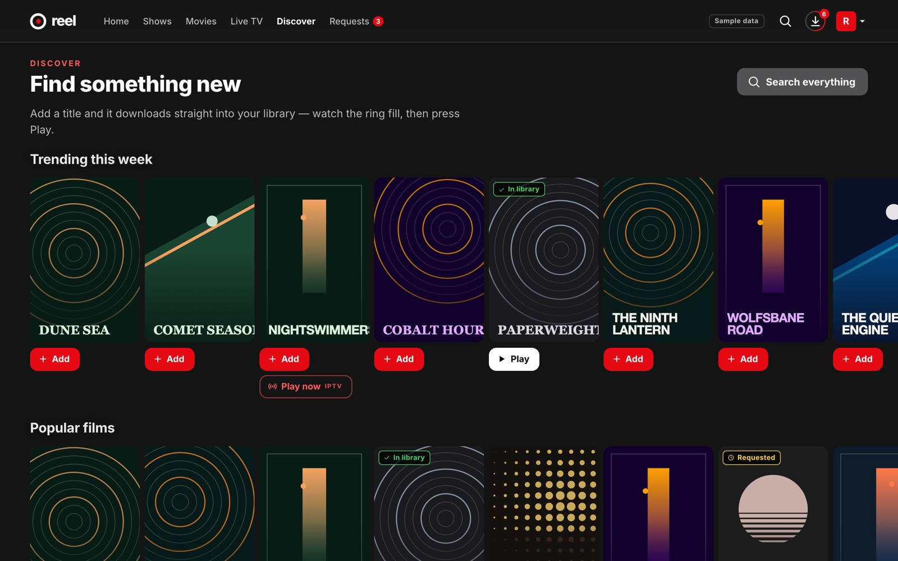
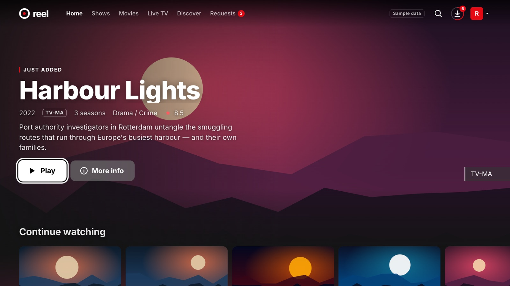
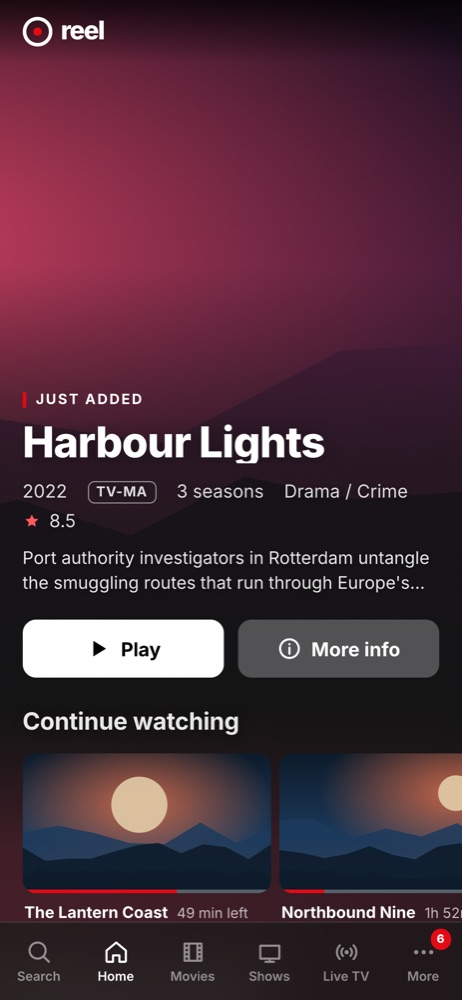

<p align="center">
  
</p>

<h1 align="center">Reel</h1>

<p align="center">
  <b>A self-hosted media server for your movies, your shows and your live TV.</b><br>
  Your library, Seerr-style requests and an IPTV engine in one Rust binary, with web, TV and Android clients.<br>
  No cloud account, no telemetry.
</p>

<p align="center">
  <a href="#quick-start">Quick start</a> ·
  <a href="#features">Features</a> ·
  <a href="docs/README.md">Docs</a> ·
  <a href="docs/ARCHITECTURE.md">Architecture</a> ·
  <a href="docs/STATUS.md">Status</a>
</p>

<p align="center">
  
</p>

## Why Reel

Plex and Jellyfin play your files. Requesting something new means a second app (Overseerr / Jellyseerr), and
live TV from an IPTV plan is an afterthought that breaks when the plan allows a single connection. Reel does
all three in one place:

- **Find a film, press Add, watch the ring fill, press Play.** Requests go straight to Radarr or Sonarr and the
  download progress shows up live wherever the title appears: search, the title page, an actor's filmography.
- **Live TV that respects your provider.** One upstream connection per channel however many people watch it,
  the newest stream wins on a one-connection plan, and the guide is stitched together from public XMLTV
  sources when the provider has none.
- **Built for the couch as much as the desk.** The same web app runs in a browser, in 10-foot mode on LG and
  Samsung TVs with D-pad navigation, and inside an Android app for phones and Android TV.

## Screenshots

<table>
  <tr>
    <td width="50%"><br><sub><b>Title sheet</b>: TMDB ratings (IMDb, Rotten Tomatoes and Metacritic with an OMDb key), audio and subtitle choices, cast</sub></td>
    <td width="50%"><br><sub><b>Requests</b>: approvals, live download progress, one-click retry</sub></td>
  </tr>
  <tr>
    <td><br><sub><b>Live TV</b>: what's on now, favourites and groups across thousands of channels</sub></td>
    <td><br><sub><b>Guide</b>: a virtualized channel × time grid</sub></td>
  </tr>
  <tr>
    <td><br><sub><b>Discover</b>: trending and popular titles, one click to add</sub></td>
    <td><br><sub><b>TV mode</b>: 1920×1080, arrow keys or a remote, no pointer needed</sub></td>
  </tr>
</table>

<p align="center">
  
</p>

<sub>Screenshots use the web app's built-in sample data (<code>?mock=1</code>); the artwork is generated.</sub>

## Features

**Library**
- Scans movies, shows and anime; follows renames and moves without losing watch state; handles
  multi-episode files.
- Metadata and artwork from TMDB, or entirely from local `.nfo` files and images if you'd rather not use it.
- A movie picker for the "what do we watch tonight" problem: lanes like *Because you watched…*, *under 100
  minutes* and *top rated you haven't seen*, filters, and **Surprise me**.
- Search across your library, people, TMDB and the IPTV catalog from one box (`/` or ⌘K).

**Requests and downloads**
- Search TMDB, press **Add**, and Reel files it with Radarr or Sonarr. Admins and trusted users skip
  approval; everyone else gets a queue and per-user quotas.
- A live progress ring (searching → downloading 48% → importing → ready) pushed over WebSocket, with
  speed, ETA and peers from qBittorrent or Transmission.
- Radarr/Sonarr webhooks trigger a rescan of just the imported path, so a finished download is playable
  within seconds.

**Playback**
- Chooses direct play, remux, audio-only transcode or full transcode per device, and tells you why.
- Hardware transcoding with VAAPI (measured at 8.3× realtime for 1080p → 720p on an Intel N100), with a
  software fallback. Intel QSV and NVIDIA NVENC work too.
- HLS built from the file's real keyframes, so seeking and resuming stay accurate on remuxed MKVs.
- Automatic audio and subtitle selection by language and preference; text subtitles become WebVTT and
  image subtitles are burned in.

**Live TV and IPTV**
- Xtream Codes and M3U playlists, with groups, favourites, search and a full guide grid.
- A shared upstream with a keyframe cache: one provider connection per channel, and new viewers start
  almost instantly.
- One-connection plans handled for you: your older stream gives way, others get a clear message and
  admins get a **Take over** button.
- The provider's movies and series (VOD) appear next to your own library, played through a single
  provider connection.
- A per-provider rate limiter that backs off when the panel says so.

**Clients**
- **Web**: SolidJS, desktop and phone layouts, plus a 10-foot TV mode with spatial D-pad navigation.
- **LG webOS** and **Samsung Tizen** TV apps that package the same UI with the TV's native player.
- **Reel Web for Android**: a WebView app for phones and Android TV.
- Casting to AirPlay, Chromecast and DLNA TVs.

**Sharing**
- Invite links with per-user library access, stream and transcode limits, bitrate caps and request quotas.
- Passkeys, authenticator apps and recovery codes; a second factor is required for admin accounts.
- Sign a TV in by approving it on your phone. Optional Google, Microsoft or OpenID Connect sign-in.
- Signed, revocable media URLs, so native players work without auth headers.

Every feature, with what's verified on real hardware and what's only built and tested, is in
[docs/FEATURES.md](docs/FEATURES.md).

## Quick start

You need Docker with Compose, and your media somewhere on the host. A GPU is optional.

```sh
git clone https://github.com/mrafik92/reel.git && cd reel/deploy
cp .env.example .env        # set MEDIA_DIR; a TMDB key is optional
docker compose up -d --build
```

Open `http://<host>:8420`. The first visit creates the admin account. Then add a library in
**Settings → Libraries**: your media is mounted read-only at `/media`, so use paths like `/media/movies`.

- No GPU, or on macOS / Windows: add `-f docker-compose.yml -f docker-compose.nogpu.yml`.
- HTTPS with automatic certificates: set `REEL_DOMAIN` in `.env` and run `docker compose --profile caddy up -d`.

[deploy/README.md](deploy/README.md) covers the rest: invites, Radarr/Sonarr and webhooks, remote access,
GPU setup, IPTV and DLNA.

## How it's built

```
server/    Rust workspace: axum, tokio, sqlx on SQLite, ffmpeg as a subprocess
clients/   bun workspace: SolidJS web app, webOS and Tizen packaging, generated TypeScript SDK
           android-web/  Reel Web for Android (Kotlin, WebView)
deploy/    Dockerfile, Compose files, Caddyfile
docs/      features, architecture and design decisions, status, operations
```

One process serves everything: a REST API described by OpenAPI, a WebSocket for live updates, HLS and
byte-range media, and the web app itself. State is a single SQLite file. The server is split into crates
by job (`scanner`, `metadata`, `playback`, `iptv`, `requests`, `auth`, `api`), and every design choice is
written down with its reason and trade-off in [docs/ARCHITECTURE.md](docs/ARCHITECTURE.md#5-architecture-choices-and-why).

## Development

```sh
# server on http://localhost:8420 (Rust 1.86+, ffmpeg on PATH)
cd server && cargo run -p reel-api --bin reel-server

# web app with hot reload; proxies /api to :8420
cd clients && bun install && bun run dev
# …or with no server at all, on sample data: open http://localhost:5173/?mock=1

# after an API change: regenerate the OpenAPI spec and the TypeScript SDK
cd server && cargo run -q -p reel-api --bin export-openapi > openapi.json
cd clients && bun run --filter @reel/sdk generate
```

Checks before a PR: `cargo fmt --check`, `cargo clippy --workspace --all-targets -- -D warnings`,
`cargo test --workspace` in `server/`, and `bun run typecheck && bun run build` in `clients/`.

## Project status

Reel is a young personal project: one maintainer, started in October 2026, and in daily use on a home
server for one household. Library playback, requests, live TV, the web app, the LG TV app and the Android
app are in real use. Some newer pieces are built and tested but not yet checked on real hardware, such as
the Samsung Tizen app, casting and the newest sign-in options. [docs/STATUS.md](docs/STATUS.md) keeps an
honest list.

Keep it on your LAN or behind a VPN such as Tailscale for now. The security review that has to pass before
Reel faces the open internet is tracked in the *M2 – Security gate* milestone.

Bug reports and ideas are welcome as [issues](https://github.com/mrafik92/reel/issues/new/choose). Please
report security problems privately instead: see [SECURITY.md](SECURITY.md).

The original design spec is in [SPEC.md](SPEC.md); the docs in [docs/](docs/README.md) supersede it.

## License

Reel is free software under the [GNU Affero General Public License v3.0 or later](LICENSE). You can run,
study, change and share it. If you run a modified version for other people, including over a network,
you have to offer them its source under the same license.
