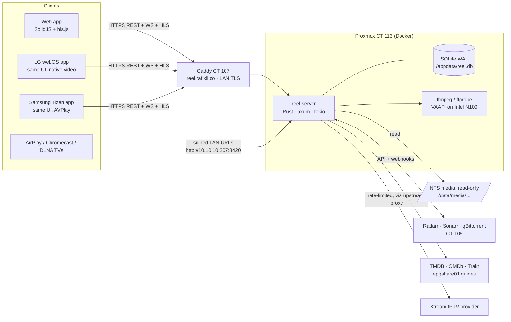
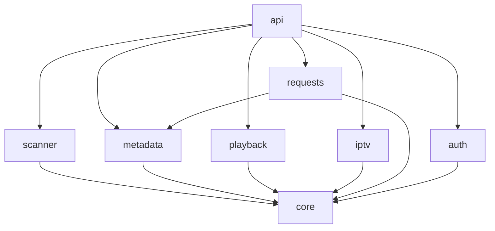
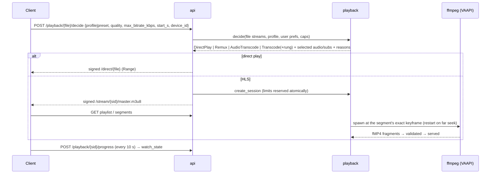
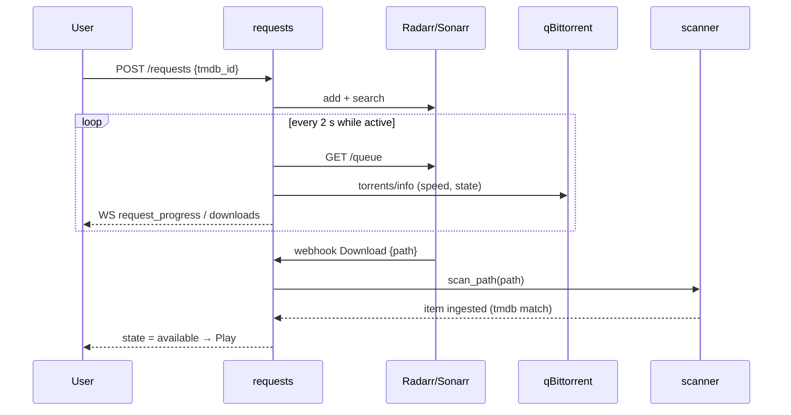

# Architecture

## 1. System overview



All of Reel runs as one process. Every client talks to it over one REST API (OpenAPI, 102 paths), one
WebSocket (`/api/v1/events`) for live updates, and HLS or byte-range HTTP for media.

## 2. Server: crate map

`server/` is a Cargo workspace (~62k lines of Rust, ~375 tests). Dependencies point downward, and `api` is
the only crate that knows about HTTP routes.



| Crate | Responsibility | Key ideas |
|---|---|---|
| `core` | Config (TOML + `REEL_*` env), SQLite pool + migrations (`migrations/0001…0015`), `ServerEvent` | Write transactions use `BEGIN IMMEDIATE`, which fixed SQLITE_BUSY_SNAPSHOT under concurrent scans |
| `scanner` | Filename parser, ffprobe ingest, incremental scan, rename detection, file watcher | Symlink-safe walk; local ffprobe restricted to the `file` protocol |
| `metadata` | TMDB client + matcher, local `.nfo`/art enricher, image cache, bounded remote fetch (`fetch.rs`) | Local data beats TMDB; locked fields are never overwritten. Local artwork is only served after it resolves inside a library root and passes a magic-byte check (A19). Remote images are fetched with byte/time caps, single-flight and a disk budget (A33) |
| `auth` | Users, sessions, invites, permissions, limits, Argon2, signing, audit | Signed URLs = HMAC(scope, user, exp, **sign_epoch**). Argon2 runs in bounded slots, and a failed attempt is recorded *before* verification |
| `playback` | Device profiles, decision engine, quality ladder, ffmpeg arg builder, session manager, keyframe index, segment validator, subtitles, upstream proxy | One ffmpeg per session; the playlist comes from the source's real keyframes; a global ffmpeg process budget; a scratch-disk budget |
| `iptv` | M3U/Xtream/XMLTV ingest, multi-guide EPG matching, channel hub (shared upstreams, GOP cache, connection budget), HLS packager, SSRF guard (`net.rs`), per-source politeness limiter | Newest stream wins for the same user; nothing is held warm when the plan allows only one connection |
| `requests` | Radarr/Sonarr clients, request workflow, download tracker, torrent adapters, webhooks, notifications, TMDB discovery | Polls the Arr queues every 2 s only while something is active; webhooks fill the gaps between polls |
| `api` | axum router, DTOs, OpenAPI (utoipa), WebSocket, static web app, cast/DLNA, VOD, browse/search/people/reviews | `AuthUser`/`AdminUser` extractors, plus permission checks on every route |

## 3. Key flows

### 3.1 Playing a library file



- **Decide.** The server picks the mode from the codecs and container, the subtitle type, HDR, and the bitrate
  cap, which is the minimum of the client's bandwidth hint, the user's limit and the profile. Above the cap it
  uses the ladder: 1080p at 8 Mbps, 720p at 4 Mbps, 480p at 2 Mbps. Browsers (MSE players) downmix multichannel
  AAC and Opus themselves, so a copy isn't limited by the channel count they report, except that AAC above 5.1 is
  never copied to them: 7.1 AAC carries a program config element or channel config 12, which Chrome's MSE parser
  rejects, so the stream never starts. It is re-encoded to 5.1 AAC with the video still copied.
- **Keyframe plans.** For copy and remux, the segment boundaries in the playlist are the source's real keyframes,
  read from the MKV Cues or MP4 `stss` index. Only when the file has no index does Reel run a background
  ffprobe, at low priority, and cache the result.
- **Encoded keyframes.** A transcode forces IDR frames from an explicit list of the plan's segment starts
  (absolute source times, only the boundaries after the restart segment: the encoder's first frame is the IDR) with no other keyframes (`-g 100000`), and
  ffmpeg cuts a file at each one. Restarts at any segment land on the same frames; the old expression relative
  to the previous keyframe drifted 4 ms per segment at 23.976 fps. A session can hold extra encoded variants
  on the same plan (`create_session_with_rungs`, #111 ①); each has its own ffmpeg, started on its first
  request, and on a source-keyframe plan its segments are checked against the plan's start and length. Decide
  creates such sessions for players that send `adaptive: true` (②); the web player sends it when hls.js plays
  the stream (③).
- **Segment safety.** A segment is served only once its boxes are complete and it belongs to the current
  ffmpeg run. The init segment stays the same across restarts.

### 3.2 Request → download → available



### 3.3 Live TV

```
provider ──(1 connection per channel, rate-limited)──► hub upstream task
     ├── MPEG-TS ring buffer + GOP cache (latest keyframe)
     ├── passthrough /iptv/live/{sid}/stream.ts   (TV native players, zero CPU)
     └── shared HLS packager (ffmpeg -c copy, or VAAPI transcode) → browsers

provider HLS (.m3u8) ──► upstream proxy (127.0.0.1, guarded client) ──► ffmpeg -c copy → MPEG-TS ──► hub

provider ──(the device opens its own connection)──► device      mode "direct" (opt-in)
     Reel holds only the budget slot (an `ExternalSlot`) and expects a heartbeat
```

- **Browser HLS window.** The shared packager writes fMP4 segments of ~2 s (the first one 1 s, for a fast tune)
  into a 15-segment (30 s) sliding playlist, and keeps each segment on disk for another 10 segments (~20 s) after it
  leaves the playlist (`-hls_delete_threshold`), so a request from a viewer who fell behind still finds its file
  (#93). Audio is copied only when it is ADTS AAC; LATM AAC (stream type 0x11), MP2, AC-3 and others are encoded
  to AAC.

- **Direct mode.** With `REEL_ALLOW_DIRECT_LIVE`, `POST /iptv/channels/{id}/tune {"mode":"direct"}` claims a
  provider slot under the usual policy (own sessions: newest wins; others: 429; admins: takeover) and returns the
  provider URL instead of a signed Reel URL. It never shares a hub pipe, because a second viewer on the same
  channel would be a second provider connection. The device calls `POST /iptv/sessions/{id}/keepalive` every 15 s;
  after about 30 s of silence (or `DELETE /iptv/sessions/{id}`) the session ends and the slot returns. The provider
  URL is never serialized in session lists and the tune is audited (`iptv_direct`).

- **HLS upstreams.** A channel whose provider URL is HLS (`.m3u8` path or an `mpegurl` content type) is remuxed
  to MPEG-TS by ffmpeg before it enters the hub. ffmpeg gets only a lease on the hub's own loopback upstream
  proxy (`http://127.0.0.1:{port}/internal/upstream/{token}/f.m3u8`, protocols `http,tcp,crypto`). The proxy
  sends the source's user agent and referrer, applies the SSRF policy to every playlist, segment and key, and
  rewrites each nested URI to a token. Live leases use a sliding expiry (120 s after last use), a reloaded
  playlist maps the same segment to the same token, and a redirected playlist is reloaded from its redirect
  target the way a player would. Dropping the connection kills ffmpeg and revokes every token of the lease.
  Raw MPEG-TS channels are read by the hub's guarded HTTP client directly; direct mode bypasses the hub.
- **Budget.** A per-source connection budget enforces the provider's `max_connections`. If the same user tunes
  again, their older session is stopped first.
- **Guide.** Reel imports the provider's XMLTV (empty for this provider), then each external guide URL in
  priority order. Channels are matched by tvg-id first, then by name keys normalised for prefixes, quality
  tags, country suffixes, Arabic letter variants and so on. A channel takes its programmes from the first
  guide that actually has some for it.

### 3.4 IPTV VOD

The catalog (categories, streams, series) is imported during the source refresh. Details load lazily the first
time someone opens a title (`get_vod_info` / `get_series_info`) and are enriched with TMDB data when the
provider supplies an id. Playback goes through the same decision engine. ffmpeg reads the provider through a
**loopback upstream proxy** that holds the credentials, applies the SSRF policy and rewrites HLS manifests, so
provider URLs never show up in argv, logs or client responses. Direct play is proxied by `/vod/direct` (with
`Range`). Every VOD request uses the source's configured User-Agent. A VOD playback holds one slot of the
provider's connection budget (shared with live TV); when the session ends (stop, takeover, idle reap), its
in-flight direct-play responses are cut by a per-session stop signal, so a paused client can't keep the
provider connection open. ffmpeg's input is registered **exclusive** in the proxy: one provider connection per
session, newest request wins (A26). A VOD remux (video copy) gets the same keyframe-true VOD playlist as a
library remux: the keyframe index is read from the container metadata (MKV Cues / MP4 `stss`) with a few
`Range` requests through that same exclusive token before ffmpeg starts, and cached per title (A27). A seek
restarts ffmpeg with `-ss` at the target keyframe. Without a readable index (no `Range` support, a container
without one, a limit hit) the session falls back to ffmpeg's growing EVENT playlist, which players treat as live
and can't seek in.

## 4. Clients

```
clients/
├── packages/sdk   openapi-typescript types + fetch client + WS helper (ws tickets)
├── packages/ui    shared SolidJS components, PlayerAdapter (HlsJs / WebOS / AVPlay), device-profile
│                  detection (MSE probing incl. HEVC), platform layer (remote keys, server URL), progress store
└── apps/
    ├── web        the app (routes: Home, Movies/Shows (library · IPTV), Discover, Search, Person, Item,
    │              Player, Live TV + Guide, Requests, Downloads, Settings (Playback for everyone,
    │              server sections for admins))
    ├── webos      packages apps/web (VITE_TARGET=tv, relative asset base) + appinfo.json
    └── tizen      same, with config.xml + AVPlay privileges
android/           native Kotlin app for Android TV + phones (Compose, Media3/ExoPlayer), its own Gradle
                   project outside the bun workspaces. Built: the skeleton (#185), connect + sign-in (#186: data/ = API
                   models, ReelApi, SessionStore, SessionManager) and the shell (#187: ui/shell = nav rail /
                   bottom bar + destination registry, ui/tv = focus kit, ui/common = cards, images, load
                   states). Plan: docs/design/29-android-app.md
```

One UI codebase covers the browser, LG and Samsung. The differences are confined to a `PlayerAdapter` and a
platform layer. The browser adapter (`HlsJsAdapter`) recovers from failures itself (`packages/ui/src/recovery.ts`):
network errors reload at the playhead or the live edge with backoff, MSE errors go through `recoverMediaError` →
`swapAudioCodec` → a rebuild, long stalls count as network failures, and only after 8 attempts does the app see a
fatal error (it then reopens the session or re-tunes once before showing it). Recovery keeps the viewer's
play/pause state: the adapter remembers whether the viewer wants it playing (its own `play()`/`pause()`, plus
element events outside a recovery step), and only then calls `play()` after a reload (#100). The web player
pings progress every 10 s while playing and while paused (`paused: true`, for up to 30 min of pause). A ping
that gets a 404 means the server ended the session, so the player opens a new one at the playhead (#95). In the web app, `lib/connection.ts`
signals "the app is back" (tab visible, online, back/forward cache); the events socket, the start-up check and
"Can't reach Reel" screens retry on it, and the shell re-mounts a page whose reads failed once the
server answers again. `api/http.ts` tags every status-0 `ApiError` with why no answer came (`aborted`, `offline`,
`timeout`, `network`); reads are retried once on a network failure, never when cancelled, and `ErrorState` renders
nothing for a cancelled request (#90). Web builds use absolute asset paths so deep links work, while TV packages use relative paths
because they load from `file://`.

## 5. Architecture choices (and why)

| # | Choice | Why | Trade-off accepted |
|---|---|---|---|
| A1 | **Rust (tokio + axum), single binary** | Many long-lived streams (IPTV fan-out, HLS) with predictable memory on a 4 GB LXC; no GC pauses; one deployable artifact | Slower to iterate than Go or TypeScript; heavy builds (~10 min cold in CI) |
| A2 | **ffmpeg/ffprobe as subprocesses, never linked** | No FFI or build fragility; an ffmpeg crash can't take down the server; HW backends come from the distro's ffmpeg | Process management, stderr parsing, argv hygiene (handled by the redactor and the upstream proxy) |
| A3 | **SQLite (WAL) instead of Postgres** | No extra service; plenty for a household plus friends; backups are one file | Single writer, so write transactions use `BEGIN IMMEDIATE` and a 30 s busy timeout |
| A4 | **Direct play first, HLS fMP4 otherwise, keyframe-indexed VOD playlists** | Most TV clients decode HEVC/HDR/AC3 natively. A VOD-style playlist allows seeking anywhere; keyframe-true boundaries keep remux segments valid | Restarts on far seeks; segment validation adds complexity |
| A5 | **Native keyframe index readers (MKV Cues / MP4 stss)** | A whole-file ffprobe over NFS took 13+ minutes; reading the index takes kilobytes | Needs an ffprobe fallback for files without an index |
| A6 | **Adaptive streaming by multi-variant HLS: the original (video copied) plus lazily started VAAPI rungs on one shared segment plan; hls.js switches per segment** (#111; replaces "one rendition per session". Design approved 2026-11-17, [design/111-multivariant-hls.md](design/111-multivariant-hls.md); part ① built 🧪: aligned variants in the session manager. Part ② built 🧪: decide plans the variant set and serves the multi-variant master to players that send `adaptive: true`; rungs are admitted lazily and stopped when idle. Part ③ built 🧪: the web player sends `adaptive` and its bandwidth estimate when hls.js plays the stream, starts on `start_variant`, and applies the quality choice as an hls.js pin or cap without a new session) | Every stall measured over Tailscale (#102, a link swinging 1.6–27 Mbit/s) came from one fixed rendition, and changing it meant a new decide, a new session and an ffmpeg restart. A pre-encoded ladder doesn't fit the N100 (≈19 GPU-hours and ~330 GB for one rung), but a remux runs at ~107× realtime with no GPU and a 720p rung at ~9×, so "original + rungs that only run while the player fetches them" fits the 3-transcode cap. Rungs force IDR frames at exactly the plan's segment starts, which are the source's own keyframes when the original is copied, so every variant has the same boundaries and the player switches at any segment with no server round-trip. Rungs keep the original's video codec family and identical audio because hls.js ABR never switches across codec sets | A session can run two ffmpegs while the player switches (a second process slot, more scratch disk). The first segment after a switch or a far seek waits for that variant's ffmpeg (~1 s for a rung). A lazy rung is refused (429) when the caps are full: hls.js doesn't retry a 4xx, puts that level in its penalty box and stays where it is. The client starts loading only after it has set the start level (`autoStartLoad: false`) and turns off hls.js's bandwidth test, which would otherwise fetch a throwaway segment of the lowest rung and start its ffmpeg on every play. Levels are matched to variants by URL path, not index, because hls.js drops levels whose `CODECS` the browser rejects. Only hls.js players get several variants: casts, native-HLS players (Safari, webOS, Tizen), IPTV VOD (one provider connection, A26) and files without a keyframe index keep one rendition chosen at decide time. AV1/VP9 originals get no rung (the N100 can't encode a same-family one) |
| A7 | **One shared SolidJS UI for web, webOS and Tizen** | webOS and Tizen are web runtimes, so one codebase gives three platforms; Solid is fast on weak TV CPUs | Must target Chromium 68 (no heavy CSS effects) |
| A8 | **Built-in requests talking to Radarr/Sonarr** | One app instead of Plex + Seerr; progress rings tied straight to the queues | Coupled to the Arr v3 APIs |
| A9 | **Download progress from the Arr queue + optional torrent adapter** | The queue alone is enough for the ring; the torrent client adds speed, peers and stuck reasons | Two sources have to be reconciled (matched by infohash) |
| A10 | **IPTV hub: one upstream per channel, a GOP cache, a connection budget** | Providers limit connections (this plan allows 1); near-instant zapping; no duplicate bandwidth | Hub complexity; newest-wins policy for a single user |
| A11 | **Multi-guide EPG with name matching** | This provider ships no guide data; free per-country XMLTV files fill the gap | Name matching can mis-map a channel (manual override per channel is available) |
| A12 | **Signed, short-lived media URLs (HMAC + sign_epoch)** | TVs, Chromecast and native players can't send auth headers; the epoch makes URLs revocable | A URL is a bearer capability until it expires (1 h playback, 8 h cast) |
| A13 | **Opaque session tokens (hashed at rest), not JWT** | Instant revocation, small surface | Every request looks the token up in the DB (cached) |
| A14 | **Private by default, reached over Tailscale** | Unaudited new code; casting and IPTV are home-network features | Remote speed depends on the Tailscale path (now direct, 9–15 Mbps) |
| A15 | **Image build in GitHub Actions → GHCR (private) → pulled on CT 113** | The N100 doesn't spend time building; reproducible images; pull-only token on the server | ~10 min per server change (web-only changes take ~1 min thanks to layer caching) |
| A16 | **Internal upstream proxy for ffmpeg** (VOD, remote probes/subtitles and live HLS upstreams) | ffmpeg ignores the app's SSRF checks and puts credentials in argv; the proxy enforces both | One more hop for VOD reads and live HLS segments |
| A18 | **Deploy from GitHub via a self-hosted runner on the LAN, gated by a manual "Run workflow"** | GitHub can't reach CT 113 and there are no inbound ports; the runner only connects outbound. The click is the gate (works on any GitHub plan; no surprise restarts mid-movie); full audit trail in Actions; tickets move to Deployed in the same job | One more CT to maintain. The runner holds a deploy key (pinned on minix to a two-verb forced command) and a PAT with `repo`+`project`. The repo must stay private |
| A19 | **Local artwork is confined at serve time, not at scan time** | A poster that is a symlink (`poster.jpg -> signing.key`) was streamed raw. The image route now canonicalizes the `file://` path (symlinks and `..` resolved), requires it to sit under a `libraries.paths_json` root, caps the size (32 MB) and sniffs JPEG/PNG/WebP magic bytes. Checking on every request also covers rows written before the fix and symlinks swapped in after a scan. `ImageCache::get` refuses `file://` outright; only `get_in` with roots allows it | One extra `canonicalize` + 12-byte read per uncached request. A library whose `paths_json` is empty or stale gets no local artwork (404) |
| A20 | **Direct Live TV playback is opt-in per server (`REEL_ALLOW_DIRECT_LIVE`) and per device, and still counts against the connection budget** | Saves server CPU/bandwidth and can be faster on slow remote paths; some players do better against the provider than against Reel's relay | The provider URL carries the provider login, so it reaches the device, which breaks the "credentials never leave the server" rule for anyone who turns this on. Reel can't see the stream, so it relies on a heartbeat. No GOP cache or shared upstream, so zapping is slower. Browsers mostly can't play it (falls back to the server) |
| A21 | **Fixed ingestion budgets for playlists, guides and the Xtream API (`iptv::limits`), as constants, set several times above the real provider** | The bytes come from a third party: a broken or hostile provider/guide host could stream forever, send a gzip bomb, one endless XML text node or M3U line (quick-xml and the line splitter buffer a whole token), or millions of records, and exhaust the 3 GB container or a worker. Caps: playlist 512 MiB / 10 min, M3U line 64 KiB, 500k channels; Xtream answer 256 MiB / 120 s, 500k VOD items, 50k categories; guide download 1 GiB / 20 min, 4 GiB after gunzip, XML event 1 MiB, attribute 8 KiB (longer ignored), text 16 KiB (truncated), 200k guide channels, 20M programmes. The real provider is ~41k movies, ~15k series and a few hundred MB of guide. Downloaded guides are a drop-guard temp file, so every error path deletes them | Hitting a cap fails that refresh (the error is recorded on the source/guide; the previous channels, guide and catalog stay). Changing a limit needs a rebuild, not an env var. Long descriptions are cut at 16 KiB |
| A22 | **sqlx is built with SQLite only, from one workspace entry; `cargo audit` exceptions live in `server/.cargo/audit.toml` with a reason** | No MySQL/Postgres driver code (or its `rsa` dependency, RUSTSEC-2023-0071) in the binary. One declaration means no crate can quietly turn default features back on. A CI step fails if `sqlx-mysql`, `sqlx-postgres` or `rsa` enter the build graph | `Cargo.lock` still lists `sqlx-mysql`/`rsa` (cargo records disabled optional deps, rust-lang/cargo#10801), so the audit needs one documented ignore until sqlx 0.9 (rustc 1.94) |
| A23 | **XML text is collected per element and trimmed at its end tag, not by the reader** | quick-xml ≥ 0.38 reports `&amp;`/`&#233;` as separate events; the reader's `trim_text` would eat the spaces around them ("News &amp; Weather" → "News&Weather"). Predefined and character references are resolved by Reel | Unknown named entities (no DTD support) are kept verbatim (`&nbsp;`) instead of failing the whole guide import |
| A24 | **Live HLS upstreams use the upstream proxy with sliding, lease-scoped tokens** (#11) | Before, the hub gave ffmpeg the provider URL: the login sat in argv and `/proc`, and ffmpeg fetched segments and redirects with no SSRF check. A live playlist is reloaded every few seconds, so fixed-expiry tokens would expire mid-stream and fresh tokens per reload would fill the token map; reusing a token per (lease, URL) and expiring it 120 s after last use keeps the map bounded. Reloading from the redirect target matches what ffmpeg did itself, so the provider doesn't see a new login per reload | One more loopback hop per segment. The proxy has no politeness gate of its own (the hub paces the connect, ffmpeg does the reloads). A provider whose redirect target expires makes ffmpeg fail and the hub reconnect, as before |
| A25 | **A VOD direct-play response lives only as long as its playback session** | On a one-connection provider, a paused or abandoned browser tab would otherwise hold the provider connection after a takeover or stop, and the new viewer would get HTTP 46x | A task per direct-play response pumps the provider body; a long `bytes=0-` stream is cut once the session is idle-reaped (the web player keeps it alive with progress reports) |
| A26 | **A session's ffmpeg input holds at most one provider connection: in the proxy, a new request cuts the previous one and waits for it to close (`UpstreamOpts::exclusive`)** | ffmpeg's HTTP seek opens the new connection before closing the old one ("if it fails, continue on old connection"), so each seek briefly needed two connections, which a one-connection provider refuses (HTTP 46x) | A seek that has to cut an open connection waits ~100 ms longer. If the new request fails, ffmpeg's fallback to the old connection finds it cut and reconnects. Only for single-reader inputs: HLS tokens (renditions load in parallel), probe/subtitle leases and browser direct play aren't exclusive |
| A27 | **Remote remux reads the keyframe index from the container over `Range` (#92)** | Remote copy sessions used to skip the index (a full scan would download the file), so they served ffmpeg's EVENT playlist without ENDLIST. hls.js treats that as live (`duration = Infinity`, nothing seekable), so IPTV VOD remux could not be seeked at all. The MKV Cues / MP4 `stss` readers (A5) only need the head and the index, so a buffered `Range` reader (1 MiB blocks, at most 12 requests / 24 MiB / 8 s, `206` required) reads them through the session's exclusive proxy token, one request at a time, before ffmpeg opens the input. The index is cached under `keyframes/{file}-remote-{sha256(url)[..8]}.json` (no URL or login in the name) and only reused if it still covers the probed duration | Starting a remote remux makes 2–4 extra provider requests the first time (none once cached) and waits for them. A provider that changes a file without changing its URL or duration gets a stale index until the cache is cleared. Containers without an index (TS, AVI) or a provider without `Range` still get the unseekable EVENT playlist |
| A28 | **hls.js plays HLS in every MSE browser, Chrome included; native HLS only on Safari/Apple and where MSE is missing** (#91) | Chrome now answers `canPlayType("application/vnd.apple.mpegurl")`, so the adapter had silently switched to Chrome's built-in player: a small fixed buffer, no retry, and it stops on the first bad segment (`CHUNK_DEMUXER_ERROR_APPEND_FAILED`). With hls.js the app controls the buffer (~90 s for VOD), timeouts and error recovery | hls.js (~190 KB gzip) is fetched for every HLS stream in Chrome/Firefox (lazy, not on first paint). Safari keeps its native player for AirPlay, so its recovery is the simpler "reload at the playhead" path |
| A29 | **Players recover by themselves before they report an error; the app re-tunes or reopens the session once** (#91, #93, #81) | Remote links (Tailscale, HTTP/3 over a 1280 MTU) drop or truncate responses now and then, and live segments rotate out. Stopping on the first fatal error turned every blip into "Playback stopped". The one-shot reopen covers a server session that was reaped while the player was stuck | A truly broken stream shows its error ~1–2 minutes later than before. Re-tuning uses one extra tune request (at most once a minute), which is gentle on the one-connection provider |
| A30 | **Overlays (sheets, toasts) portal into the full-screen element when there is one, otherwise `<body>`** (#94) | The web player goes full screen on its own stage, and the browser only paints that subtree, so sheets and toasts portaled to `<body>` opened invisibly. A shared reactive mount (`overlayMount()` in `@reel/ui`, driven by `fullscreenchange`) fixes every overlay without threading a ref through each caller; Solid's Portal moves the overlay if full screen changes while it's open, and sheets put focus back inside after the move | Overlays inside the player inherit its stacking context (sheets z 100 and toasts z 250 still sit above the controls). Overlays not yet on `overlayMount()` (Picker, DiscoverSheet, VOD sheets) stay on `<body>`; none of them open from the full-screen player |
| A31 | **Settings is one layout for every user; personal sections live under `/settings/…`, server sections under `/admin/…`** (#88) | Playback looked like a sibling of Libraries in the nav but opened as a separate page, so the nav disappeared and TV focus lost its place. Rendering it in the same layout (`Admin` with `section="playback"`) keeps the nav, and keeping its URL means existing links from the player and item sheets still work. The nav is a `data-nav-lateral` side rail when it sits beside the pane (wider than 960px, always on TV): left/right hop between nav and pane even when the pane's first control is lower than the nav link, and up/down stay on their side | Two URL prefixes for one page. Below 960px the nav is a strip above the pane, so it isn't lateral there (up/down must reach the pane) |
| A32 | **A paused player keeps its converted session: "paused" pings, and a 30 min idle timeout for sessions whose last ping said paused** (#95) | A paused player with a full buffer requests nothing, and background tabs throttle timers, so the 60 s idle reaper killed paused transcodes/remuxes and resuming hit a 404. ffmpeg is already SIGSTOPped by the read-ahead throttle, so a paused session costs only scratch disk and its transcode slot. Direct play keeps its 300 s timeout (a VOD direct-play response holds a provider connection, A25) | A tab closed while paused holds a transcode slot for up to 30 min instead of ~1 min. The web player stops its paused pings after 30 min of pause, so a forgotten tab frees the slot within ~1 h; pressing play later opens a new session at the same spot |
| A33 | **Remote image caches are bounded: streaming byte cap + deadline, single-flight per file, remembered failures, a disk budget with LRU eviction** (#9) | TMDB images (any signed-in user can ask for any TMDB path), channel logos and VOD artwork (URLs from the provider) were read whole into memory before the size check, each concurrent request downloaded the same file again, the per-key lock map never shrank, and the cache directories had no limit. Now `reel_metadata::fetch` stops a body at the cap (TMDB 32 MiB, IPTV 2 MiB; an announced `Content-Length` over the cap fails before any byte) or the deadline (30 s / 10 s), one lock per file key collapses concurrent fetches and resizes into one and is removed when the last waiter leaves, failures are remembered (30 min for 4xx/too large/not an image, 2 min for timeouts/5xx, at most 4096 keys), only JPEG/PNG/WebP (and GIF for logos) is cached, and each cache has a byte and file budget (`image_cache_max_mb` 4096 / 200k files, `iptv_image_cache_max_mb` 1024 / 100k files): over it, the least recently used files (mtime, refreshed at most hourly on a hit) are deleted down to 90 %. Resizing decodes with limits (16k px per side, 512 MiB) | A cache hit can cost one `utime` per hour per file. A file younger than 60 s is never evicted, so a burst can sit briefly above the budget. An image that failed stays missing for up to 30 min even if the upstream recovers. Going over budget walks the cache directory once (a few ms for ~3k files) |
| A34 | **DLNA trusts only the TV's own address: the SSDP `LOCATION` must be the IP the answer came from, and the control, `URLBase` and icon URLs must be on the description's host; no redirects, capped bodies, discovery can be switched off** (#12) | Any host on the LAN (or a spoofed UDP packet) can answer an M-SEARCH. Before, Reel fetched whatever `LOCATION` it named, followed redirects, read bodies whole, and later sent SOAP calls (with signed media URLs in them) to whatever control URL the description gave, so a rogue answer could make Reel request internal URLs or point a TV entry at another box. Now an answer whose `LOCATION` isn't an HTTP URL on the sender's IP literal is ignored (at most 32 per round). A description whose AVTransport URL (or `URLBase`) leaves its host is not a device, and a foreign volume or icon URL is dropped. Descriptions are capped at 256 KiB and SOAP answers at 64 KiB, the cast client follows no redirects, and an SSDP answer can't replace a TV added by IP with the same UDN from another address. `cast_discovery = false` skips SSDP entirely; TVs added by IP still work | A TV whose control URLs sit on a different IP from its description (unusual multi-homed devices) can't be used. A TV that changes IP keeps its manual entry until it is re-added. Host names in `LOCATION` are refused; add such a TV by IP |
| A35 | **Live TV video transcodes count against the playback transcode limits, through one admission lock shared by the two session managers** (#13) | Live HLS packagers started ffmpeg outside every limit, so any user with IPTV access could tune several MPEG-2/HEVC channels and occupy the N100's encoder and CPU. A user's cap counts each viewer of a re-encoding packager (joining one included), so it limits what one account can hold; the server cap counts each packager once, because a shared packager is one ffmpeg. The two managers read each other's counts under one lock taken first by both, so a VOD and a live transcode can't both take the last slot. Zapping replaces the user's own oldest live transcode instead of failing | Audio-only re-encoding (LATM/MP2/AC-3 → AAC, needed on most channels and cheap) doesn't count, unlike playback's audio transcodes. A packager can keep running ~10 s after its last slot is released (it is reaped on idle), briefly above the server cap. A user at their cap with a playback transcode gets a 429 on a re-encoding channel |
| A36 | **Admin responses mask the IPTV provider login; edits send the masks back and the server maps them to the saved values** (#15) | The login is the provider account (and sits in every stream path, `/live/USER/PASS/…`). Returning it to the browser put it in the admin's DOM, browser memory, extensions and any proxy log, and a stolen admin session could read it. Masking at the DTO keeps the edit form simple: an unchanged masked value means "keep". A masked value that was edited around can't be resolved, so it is refused rather than saved with `***` in it. Moving an Xtream source to another scheme/host/port needs the login typed again, so the saved login can't be redirected to a server the admin didn't enter it for | The admin can't read the saved login back (no reveal button); changing it means typing it again. Two characters of a long username stay visible to tell accounts apart. A guide URL that legitimately contains `***` can't be saved |
| A37 | **The data dir is owner-only (`0700`); secrets and the database are born `0600` and repaired at startup** | Writing `signing.key` and then calling chmod left a moment where another user on the host could read it, and older builds left `reel.db`/`-wal`/`-shm` `0644` in a `0755` dir. The final mode is passed to `open`/`mkdir` itself (a umask can only narrow it), the key goes through a `0600` temp file + rename, and an empty `0600` `reel.db` is created before SQLite opens it because SQLite copies the database's mode to `-wal`/`-shm`. Repairing at startup fixes existing installs without a migration step. `unsafe` is forbidden, so the process umask isn't changed: the caches inside the data dir (images, transcode, subtitles, keyframes) keep `0644`/`0755` and are protected by the `0700` dir alone | Anything else that needs to read the data dir (a backup job, a sidecar) must run as the same uid or root. Startup can only tighten what the process owns (the container drops every capability); anything else is logged as a warning and left as is. A data dir or database path pointing at a shared directory gets that directory tightened too |
| A38 | **`/events` accepts only a ticket or an `Authorization` header; `?token=` is refused and clients never fall back to it** | Browsers can't set headers on a WebSocket upgrade, so the socket used to carry the session token in the query string. URLs are logged by every proxy on the way (Caddy, and Cloudflare once Reel is public), and that token is a 30-day bearer credential. The SDK used to fall back to `?token=` whenever the ticket request failed for a reason other than 401; it now retries with backoff instead. Web, webOS and Tizen are the same `apps/web` build on `@reel/sdk`, so one change covers every client | A client built before tickets (none are installed) can't open the live-updates socket until it is updated. A ticket costs one extra HTTP request per (re)connect |
| A39 | **Public edge (prepared, #31/#108): Cloudflare DNS-only → OPNsense WAN 443 → Caddy CT 107 `:8443` site with path blocks and security headers → Reel, which believes `X-Forwarded-For` only from Caddy (`REEL_TRUSTED_PROXIES=10.10.10.73`)** | Abroad, the owner's carrier throttles Tailscale's UDP (~3–6 Mbit/s) but not HTTPS (~47 Mbit/s). DNS-only over proxied: Cloudflare's self-serve terms don't cover serving video through its proxy (the account also holds the zone that issues every `*.rafikii.co` cert by DNS-01); proxied media would need a cache-bypass rule; immich and plex already use DNS-only on the same WAN port, so the WAN can't be limited to Cloudflare's ranges anyway; and the home IP is already public through them. With DNS-only, Caddy's TCP peer is the real client, so there is no client-IP header to trust at the edge and Caddy overwrites XFF. The same name stays split-horizon: LAN/Tailscale resolve to Caddy's `:443` and keep admin; the public site refuses `/api/v1/{admin,webhooks,cast}/*` and `POST /api/v1/setup`. Tunnel + Access was rejected: it breaks TV apps, external players and Chromecast away from home, and the same video terms apply | Admin work, "Play on…" and first-run setup need the LAN or Tailscale. No per-host geo filter (OPNsense GeoIP would cover all public names) and no edge WAF; login is protected by Reel's own lockout. CSP starts report-only. HTTP/3 is off on `:8443`; on the LAN `:443` Caddy can only stop advertising it for Reel (`Alt-Svc: clear`), not disable it per site |
| A40 | **gzip/br for HLS playlists only, chosen by the response `Content-Type` (`*mpegurl*`) in one router-wide `CompressionLayer`** (#112) | A VOD media playlist has one line per 4 s segment (175–260 KB for a film, more when signed) and compresses 30–80×; hls.js downloads all of it before the first segment request, which cost up to ~1 s over Tailscale (#102). Matching the content type instead of routes covers the session master/media playlists, live and IPTV VOD playlists and the upstream proxy in one place, without touching the playback crate. Segments, direct play, subtitles and images are already compressed or ranged, so they stay byte-for-byte as before (`Content-Length`, `Accept-Ranges`, `206`). Caddy (CT 107) has no `encode` on Reel's sites, so it passes `Accept-Encoding` and `Content-Encoding` through | Each playlist request costs some CPU to compress (tower-http's default level). Compressed playlists have no `Content-Length`, so a client sees a chunked body. A client that doesn't send `Accept-Encoding` (most TV players) gets the plain playlist, as before |
| A41 | **The person page sorts the filmography in the browser; "Top rated" trusts a TMDB average only from 50 votes, "Popular" orders by vote count** (#141) | `GET /people/{id}` already returns the whole filmography from one cached TMDB call, now with `vote_count` and `popularity` next to `vote_average`, so a sort needs no new request. On a real long filmography (Samuel L. Jackson, 341 titles) an unguarded rating sort put 1-vote 10.0 specials on top; at 20 votes a 45-vote TV special still slipped in; 50 leaves only his known films and series at the top. TMDB `popularity` scores the whole title, so talk shows with one guest spot led that order; vote count surfaces the films someone is known for | Thinly-voted titles are set aside, not hidden, so a niche gem sits below the 50-vote line. `popularity` is exposed but used only to break ties |
| A42 | **Every icon is generated from one committed SVG (`packages/ui/assets/logo.svg`) by `bun run icons`, rasterised with resvg; the outputs are committed** (#142) | Hand-made sizes drift, and the old TV icons came from a separate pixel-drawing script. One source keeps favicon, PWA, apple-touch and TV icons identical, and a new logo is a one-file swap plus one command. resvg (`@resvg/resvg-js`, a dev dependency of `@reel/ui`) renders SVG the same on every OS without a browser or system librsvg. Full-bleed (apple-touch) and maskable icons paint the tile colour behind a scaled copy of the logo, so the logo's tile colour must stay equal to `TILE` in the script (`BG` is only the webOS splash background) | Generated PNG/ICO files are committed, so a logo edit without re-running the script leaves stale icons (the script isn't run in CI). The dev dependency ships a native binary per platform, installed on `bun install` |
| A43 | **Playback quality is a per-device choice (`localStorage` `reel.playback.quality`) sent as `quality` on every decide / VOD play; the player's quality sheet re-decides from the playhead with the same `device_id`; "Original" never falls back to a video transcode silently** (#87) | The right quality depends on the connection, not the account: the same user wants Original on the LAN TV and 720p on a remote laptop, so it is stored like the Live TV delivery choice (A20) rather than in `/me/preferences`. The server already resolved `quality` and the user's bitrate limit (A6), so the client only chooses and explains. When `quality=original` comes back with a video encode (device can't decode it, HDR, picture subtitles, or the user's limit), the player stops that session and shows why with a one-tap **Play transcoded** (Auto for the rest of that play), because a silent transcode is what the choice exists to rule out. The server is unchanged; the quality fields are typed by hand in `api/types.ts` because a full `gen:api` regeneration pulls in unrelated schema drift | In a multi-variant session (#111 ③) a quality switch is local: Original pins the original level, a rung caps hls.js ABR at that size (it may still go lower on a slow link), Auto removes both. A choice the master doesn't list still reopens the session, as a single-variant one at that quality; so do all switches on players with one rendition (Safari, TVs). Auto follows the link only in multi-variant sessions. The "why" text is matched against the server's reason strings, so rewording them on the server falls back to a generic sentence. Casts don't send a quality |
| A44 | **VAAPI low-power encoders are probed per codec at startup and used for VOD transcodes; a failure steps down to the regular encoder, then software** (#113) | On the N100, `-low_power 1` (VDEnc, `EncSliceLP`) doubles HEVC and multi-rung throughput and frees the Render engine that Plex shares (#102). The probe is a real 1-frame VBR encode, not `vainfo`: low-power bitrate control needs the HuC firmware, so an entrypoint listed by `vainfo` can still fail. The flags live on `HwAccel::Vaapi`, so the session's existing hardware-failure retry only needed one more step (`vaapi-lp` in `degraded`) | Low-power encodes have fewer tools (no B-frame/trellis tuning on some generations); the spot check on 2 titles (60 s, 720p, same bitrate) measured H.264 LP within ±0.2 VMAF of the regular encoder and HEVC LP 0.4–1.4 lower, below a visible difference. Live TV keeps the regular encoder because its failure path goes straight to software. `REEL_VAAPI_LOW_POWER=0` switches it off without a rebuild |
| A45 | **A click on the video acts by `pointerType`: a mouse click plays/pauses at once and a double-click (full screen) undoes it; a touch/pen tap only shows/hides the controls, waiting 300 ms for a possible double-tap, which seeks ±10 s on the left/right third; TV mode keeps every click on the show/hide path** (#167, #183, `lib/tap.ts`) | Desktop users expect YouTube's click-to-pause, and acting at once keeps it snappy; the double-click undo means full screen never leaves the film paused. On phones a tap that paused the film by accident was the #167 bug, so touch only shows the controls. The pointer type, sampled at `pointerdown`, is the right test (a touchscreen laptop or a phone in landscape behave correctly), not screen width; a click with no pointer type takes the safe touch path. Touch double-taps are detected in our own `click` handler (`createDoubleTap`, a pure state machine) because browsers differ on firing `dblclick` for touch, and `touch-action: manipulation` stops the double-tap zoom. A webOS magic remote reports `mouse`, so TV mode keeps #167's behaviour. Controls that came up in the last 600 ms count as hidden: moving the mouse onto the picture, or the compatibility `mousemove` a tap fires, already shows them, and the tap right after must not hide them again | A double-click plays/pauses twice (pause, then undo) inside a few hundred ms. A single touch tap takes 300 ms to show or hide the controls. A tap in the centre right after a side seek streak counts as a fresh first tap |
| A46 | **Design language: one crimson accent on warm near-black with cream text; all colours are tokens in `ui.css`, with rgb-triplet twins (`--accent-rgb`, `--ink-rgb`, `--bg-rgb`…) for `rgba()` washes. The accent is split in two: `--accent` for fills with cream `--accent-ink` on top, `--accent-hi` for accent-coloured text, icons and halos on dark. Status colours avoid red: `--danger` orange, `--warn` yellow, `--live` rose, `--ok` sage** (#177) | Crimson + cream reads as cinema, the lime read as a tech dashboard. One red can't pass AA both ways: cream text on it needs a dark red (≤ L 0.15), red text on near-black needs a light one (≥ L 0.19), hence two tokens. Chromium 68 has no `color-mix()`/relative colours, so translucent variants come from `rgba(var(--x-rgb), a)`, which it does support. With a red brand, a red error or "live" dot would read as decoration, so they moved off red, and every status still carries a glyph or label | Two accent tokens to choose from in new CSS (fill vs. text). `--accent` fill on `--bg-3` is 2.86:1, under the 3:1 non-text guideline, so accent bars sit on `--ink-4` tracks rather than straight on `--bg-3`. Rose "live" and orange "error" are each about 20–30° of hue from the brand red; they rely on the label, glyph and lightness difference as much as hue |
| A47 | **Phone nav is a fixed 5 + More bottom bar; focus styling on the rail is gated to keyboard/remote input** (#180) | Eight destinations plus Settings don't fit 360–430 px without clipping or sub-44 px targets. The bar keeps what people open most and the shared `Sheet` holds the rest, so TV and desktop keep their single rail. Which items move is a `more` flag on the NAV entry; CSS hides/shows them, so there is no resize JS. The tapped link keeps focus after client-side navigation, so the inverted `:focus` pill (and the Search icon / download ring colours under it) only apply with `html[data-input="key"]` or `html.tv`; `:hover` is behind `@media (hover: hover)` except on TV | One more tap for Discover, Requests and Downloads on phones. `viewport-fit=cover` makes iOS report safe-area insets, so the rail and `.main` also pad for the left inset in landscape; full-screen pages (player, Live TV) now run edge to edge there |
| A48 | **Android is a native app (Kotlin, Jetpack Compose, Media3/ExoPlayer) in `clients/android/`, one APK for TV and phones; not a WebView around the SolidJS UI** (epic #29, [design/29-android-app.md](design/29-android-app.md)) | ExoPlayer direct-plays what browsers can't (HEVC 10-bit, HDR10/HLG/Dolby Vision, AC3/EAC3, PGS, MKV), so most titles skip the N100's scarce transcodes; Compose gives real D-pad focus on cheap Android TV sticks without the Chromium 68 limits. The server already has the `android_exoplayer` preset and `client: "android"`, and Live TV uses `passthrough` MPEG-TS like webOS/Tizen, so v1 needs no server change. The device kind (UI mode) picks the layout, never the features | The UI is written twice (SolidJS and Compose), so Android lags the web and stays smaller (no admin, requests or Discover in v1). Its API models are hand-written Kotlin (`clients/android/.../data/Models.kt`), not generated from `openapi.json`, so an API change must update them too; a unit test (`ModelsTest`) fails when a model field isn't in the server schema or the app needs a field the server may leave out, and CI runs it when `server/openapi.json` changes. A separate Gradle toolchain (JDK 17–21, Android SDK) on the dev Mac and in CI |
| A49 | **Android releases are sideloaded APKs from GitHub releases, built and signed by CI on an `android-vX.Y.Z` tag; the signing key lives only in Actions secrets and the owner's password manager; versionCode = `X*1_000_000 + Y*1_000 + Z`** (#195) | No Play Store account or review for a private app. The tag is the only trigger, so releases are deliberate and reproducible, and every APK is signed with the same key, so updates install over the old app. The version comes from the tag alone, so no file has to be bumped and a higher tag always upgrades. Passwords reach Gradle as env vars, never a file | No auto-update: each device is updated by hand (adb, Taildrop or *Downloader*). Losing the keystore means users must uninstall to move to a new key. Minor/patch are capped at 999 and pre-release suffixes aren't supported |
| A50 | **The Android app sends its bearer token only to the configured server's origin (scheme + host + port), checked per hop by an OkHttp network interceptor; it keeps the token in app-private DataStore and signs in with a random per-install `device_id`** (#186) | Media and image URLs are signed, so ExoPlayer and Coil never need the token, and a redirect or a third-party URL (TMDB images, a CDN) can't leak it. Backups and device transfer are off, so the token stays on the device. A stable `device_id` makes a re-sign-in replace that install's session and lets the playback "newest wins" rules tell the TV and the phone apart. A 401 on a signed-in call drops the token and returns to sign-in, a wrong password at sign-in doesn't; errors use the web's classes (#90) | DataStore isn't encrypted at rest (no Keystore wrapping): anyone with root on the device can read the token. Changing the server address signs out. Reads are retried once after a network blip, writes aren't (OkHttp may still replay a request that never reached the server) |
| A51 | **The Android shell uses plain Compose + Material 3 for TV (no `androidx.tv:tv-material`): a small focus kit (`FocusCard`, `FocusMemory`/`RestoreFocus`) and one destination registry (`ReelNavGraph`) with Navigation Compose string routes** (#187) | One set of components for phone and TV, no alpha-quality TV library, and every screen ticket gets the same focus behaviour (first card on entry, the card you left on Back, keyed by a saveable string) without writing its own. Tabs use the standard save/restore-state navigation, so Back goes Home and then leaves the app | The TV look (inset two-tone outline, rail) is hand-built and not the stock Google TV style. Focus restore needs every focusable element tagged with a stable key. String routes aren't type-checked (`Routes` holds the builders) |
| A52 | **Android Home and Library retain data in back-stack-scoped `ViewModel`s; Home refreshes quietly on return, while Library uses keyset paging. Playback uses one `player/{fileId}/{itemId}/{startS}` route** (#188, #212) | Home keeps its catalogue and scroll position visible while progress refreshes; the grid preserves loaded pages and avoids duplicate loads. One player route keeps browse screens independent | A failed Home refresh leaves the last catalogue visible; Library progress can be stale until reopened. `startS` travels as a string |
| A53 | **Android playback quality is a per-device setting kept in app-private DataStore (`device_prefs`), while audio/subtitle preferences stay on the account (`/me/preferences`); Settings saves each change at once and rolls back on failure** (#194) | Same split as the web: languages follow the person to every device, but the right quality depends on the screen and the network (a TV on Ethernet vs a phone on mobile data). Saving on each change needs no *Save* button, which is awkward with a remote | A device that's reset loses its quality choice (back to Automatic). The player (#190) has to read `AppGraph.devicePrefs.quality` and send it with `decide` |
| A54 | **The Android player is one `ReelPlayer` (ExoPlayer + OkHttp data source on the plain client, media3-ui `PlayerView` for picture and subtitles only) behind a `PlayerPort` interface; the VOD session logic is a pure-Kotlin `VodController` over a `PlaySource` (library decide now, `/vod/play` for #193); the controls are Compose, not PlayerView's** (#190) | Live TV (#191) reuses the same player for passthrough MPEG-TS, so the wrapper knows nothing about decide. The controller is where the web's hard-won rules live (resume with the 5-s rule, progress every 10 s and on pause with `paused`, 404 → decide again at the playhead (#95), a fatal error re-decides once a minute, local vs. server track switches, quality re-decide), and behind `PlayerPort` it is unit-tested on virtual time without a device. Media requests go through the app's plain OkHttp client, so the bearer token can't reach them (A50). PlayerView's own controller and track menus would switch tracks behind the server's back and fight the app's D-pad focus kit, so they are off and the overlay is Compose (pills with the current audio / subtitle / quality, mode badge, up-next card). When ExoPlayer reports a decoder error on a session that copies the video, re-deciding would get the same answer, so the player offers **Play transcoded** (a ladder rung) instead, like the web's A43 | Track matching is by position: sidecar VTTs by the id the app gives them, embedded subtitles and audio by container order against the server's ffprobe order (direct play / remux with copied audio only). The `android_exoplayer` preset says AAC/AC3/EAC3 etc. without asking the device, so on a device with no AC3/EAC3 decoder ExoPlayer silently plays another audio track (or none) instead of the server converting it |
| A55 | **Android IPTV VOD is its own package (`ui/vod`, routes registered by `vodGraph`) entered from an *IPTV* pill on the Library tab, and plays through the same VOD player with a `VodSource` (`POST /vod/play`) instead of a separate player; busy answers reuse the web's wording and actions** (#193) | Keeps #188's library screens and #193 apart (one link on the Library screen, one line in the graph), and every player rule from A54 (progress, 404, re-decide, tracks, quality) applies to provider titles for free because `/vod/play` answers like decide. The provider usually allows one connection, so "busy" is normal: the 429 / admin-409 bodies are read the same way as `busy.ts` (own other screen → stop it via `/playback` or `/iptv/sessions`; admin → *Take over* sends `takeover: true` once; others → who, or a plain "in use") | IPTV items aren't library items: no next episode or *Up next* in the player and no shared Continue watching row on Android yet. The busy wording lives in two places (web and Android), and it keys off the server's message text in one case (an anonymous holder) |
| A56 | **Android Live TV keeps one ExoPlayer instance when switching between docked and full screen. A separate `LiveController` serializes tune and release across screens, and reads now/next for the visible channels** (#191) | Passthrough uses the same Media3 wrapper as VOD (A54). Rapid zaps settle for 350 ms before tuning, and the next tune waits for the prior session's DELETE. A tune that finishes after leave or background has its session released before another tune starts. Batching visible IDs keeps guide requests small for large channel lists | A zap includes the settle time and any session cleanup. The player releases on background and tunes the same channel on return, so there is a short playback interruption |
| A57 | **Android focus outlines are drawn inside the existing bounds; focus memory tracks attached targets by stable key** (#209) | An inset dark-and-ivory ring stays visible on light and dark artwork without scaling or clipping; detached requesters cannot block restoration. A saved key falls back to the nearest attached item in its group, then the preferred or first attached target | The screen must provide stable grouped keys and restore its lazy scroll state to compose off-screen targets; after process recreation the fallback uses current attachment order |
| A58 | **Startup timing is local and development-only, with an attempt ID and allowlisted decision mode** (#210) | Correlates navigation, decision and first frame without recording signed media addresses or account data. Media3 events are matched to a media item before recording | Android and browser milestones have different definitions and can overlap. Physical-device and real-server measurements are still needed |

## 6. Data model (essentials)

`users`, `user_limits`, `user_prefs`, `sessions_auth`, `invites`, `audit_log` · `libraries`, `library_access`,
`media_items` (movie/show/season/episode), `media_files`, `media_file_links`, `streams`, `people`, `credits`,
`genres`, `collections` · `watch_state`, `playback_sessions` · `requests`, `request_downloads`, `arr_servers`,
`download_clients`, `notification_targets` · `iptv_sources` (+ `epg_urls`), `channels`, `channel_aliases`,
`epg_programs`, `epg_channels`, `iptv_epg_sources`, `user_channel_favorites` · VOD catalog tables, `omdb_cache`.
Migrations are in `server/crates/core/migrations` and applied on startup.

## 7. Security model (summary)

- **Network.** Private on the LAN (Caddy `*.rafikii.co`, LAN-only) and over Tailscale. Not publicly exposed.
  A public edge is prepared but not applied (A39, `deploy/ct107/`).
- **Client IP.** `X-Forwarded-For` is believed only from `trusted_proxies` (CIDRs; `REEL_TRUSTED_PROXIES`),
  and the client is the right-most entry that isn't a trusted proxy. It feeds the login lockout, the audit
  log and the LAN-only setup check. The old `trust_proxy_headers` switch (any private-range peer) still
  works and logs a warning.
- **Authentication.**
  - Argon2id with bounded concurrency.
  - Lockout per (user, IP), with a /64 bucket for IPv6.
  - `/setup` only from the LAN or with a one-time token.
  - Sessions slide for 30 days, with a 90-day absolute limit.
  - WebSocket connections authenticate with a single-use, 60-second ticket (`POST /auth/ws-ticket` → `?ticket=`) or an
    `Authorization` header. The session token is never accepted in a URL (`?token=` was removed, #28), so it can't end
    up in proxy, CDN or edge logs.
- **Authorization.**
  - Admin routes use the `AdminUser` extractor.
  - Library access is enforced on items, images, media and search.
  - Per-user flags gate IPTV, VOD, requests and casting.
  - Cast control is admin-only by default.
  - A Discover, person, search or Downloads card links to a library item only if it sits in a library the viewer
    can open; otherwise it links to a visible copy of the title, or to nothing (#15).
- **Media.**
  - Transcode limits (per user and server-wide) cover playback and live TV together (A35).
  - Signed URLs carry an epoch.
  - The stream guard decodes the session id and checks the owner.
  - Playback errors are generic (diagnostics are redacted server-side).
- **Outbound.**
  - The SSRF guard applies at connect time, including DNS and redirects. IPv6 forms that carry an IPv4
    address (mapped, translated, NAT64, 6to4, Teredo) are judged by that IPv4 address; IPv4-compatible
    `::a.b.c.d` is refused. Redirects don't send the previous URL as `Referer` (it can hold the provider login).
  - ffmpeg is mediated by the upstream proxy: VOD, remote probes and subtitles, and live HLS upstreams. No
    ffmpeg command line holds a provider URL or credential.
  - IPTV and guide ingestion have byte, time, size and count budgets (A21).
  - Image fetches (TMDB, logos, VOD artwork) are capped in bytes and time while streaming, single-flight,
    and their caches have a disk budget (A33).
  - DLNA: SSDP answers are only followed to the sender's own IP, control URLs are bound to the TV's host,
    no redirects, capped bodies, and SSDP discovery can be turned off (`REEL_CAST_DISCOVERY`, A34).
- **Secrets in admin responses.** Admin IPTV responses never carry the provider login: source and guide URLs are
  masked (`***`) and the Xtream username is shown as `ab••••` (A36). Arr API keys and notification secrets are
  masked the same way.
- **Data at rest.** The data dir is `0700`; `signing.key`, `reel.db`, `-wal` and `-shm` are `0600`, created with that
  mode (no write-then-chmod window) and tightened again at every startup.
- **Container.** Non-root, `cap_drop: ALL`, read-only rootfs, read-only media, memory/PID/CPU limits. CT 113's
  Proxmox firewall blocks LAN egress apart from the Arr hosts and qBittorrent.
- A three-reviewer security council (2026-11-03) produced the hardening backlog; see
  [STATUS.md](STATUS.md#security-posture).
