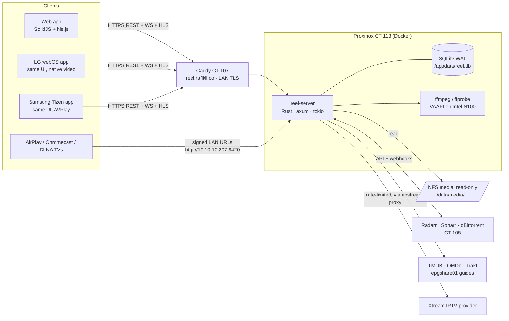
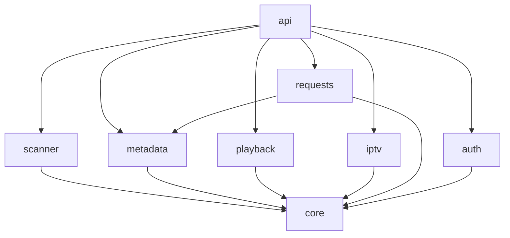
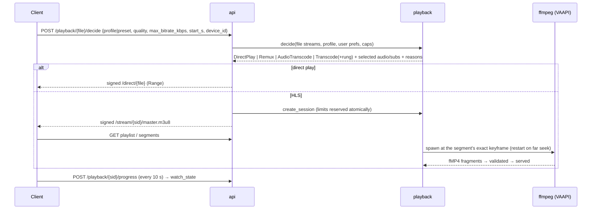
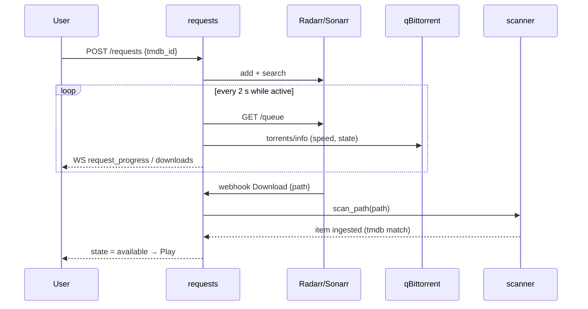

# Architecture

## 1. System overview



All of Reel runs as one process. Every client talks to it over one REST API (OpenAPI, 102 paths), one
WebSocket (`/api/v1/events`) for live updates, and HLS or byte-range HTTP for media.

## 2. Server: crate map

`server/` is a Cargo workspace (~62k lines of Rust, ~375 tests). Dependencies point downward, and `api` is
the only crate that knows about HTTP routes.



| Crate | Responsibility | Key ideas |
|---|---|---|
| `core` | Config (TOML + `REEL_*` env), SQLite pool + migrations (`migrations/0001…0015`), `ServerEvent` | Write transactions use `BEGIN IMMEDIATE`, which fixed SQLITE_BUSY_SNAPSHOT under concurrent scans |
| `scanner` | Filename parser, ffprobe ingest, incremental scan, rename detection, file watcher | Symlink-safe walk; local ffprobe restricted to the `file` protocol |
| `metadata` | TMDB client + matcher, local `.nfo`/art enricher, image cache, bounded remote fetch (`fetch.rs`) | Local data beats TMDB; locked fields are never overwritten. Local artwork is only served after it resolves inside a library root and passes a magic-byte check (A19). Remote images are fetched with byte/time caps, single-flight and a disk budget (A33) |
| `auth` | Users, sessions, invites, permissions, limits, Argon2, signing, audit | Signed URLs = HMAC(scope, user, exp, **sign_epoch**). Argon2 runs in bounded slots, and a failed attempt is recorded *before* verification |
| `playback` | Device profiles, decision engine, quality ladder, ffmpeg arg builder, session manager, keyframe index, segment validator, subtitles, upstream proxy | One ffmpeg per session; the playlist comes from the source's real keyframes; a global ffmpeg process budget; a scratch-disk budget |
| `iptv` | M3U/Xtream/XMLTV ingest, multi-guide EPG matching, channel hub (shared upstreams, GOP cache, connection budget), HLS packager, SSRF guard (`net.rs`), per-source politeness limiter | Newest stream wins for the same user; nothing is held warm when the plan allows only one connection |
| `requests` | Radarr/Sonarr clients, request workflow, download tracker, torrent adapters, webhooks, notifications, TMDB discovery | Polls the Arr queues every 2 s only while something is active; webhooks fill the gaps between polls |
| `api` | axum router, DTOs, OpenAPI (utoipa), WebSocket, static web app, cast/DLNA, VOD, browse/search/people/reviews | `AuthUser`/`AdminUser` extractors, plus permission checks on every route |

## 3. Key flows

### 3.1 Playing a library file



- **Decide.** The server picks the mode from the codecs and container, the subtitle type, HDR, and the bitrate
  cap, which is the minimum of the client's bandwidth hint, the user's limit and the profile. Above the cap it
  uses the ladder: 1080p at 8 Mbps, 720p at 4 Mbps, 480p at 2 Mbps.
- **Keyframe plans.** For copy and remux, the segment boundaries in the playlist are the source's real keyframes,
  read from the MKV Cues or MP4 `stss` index. Only when the file has no index does Reel run a background
  ffprobe, at low priority, and cache the result.
- **Segment safety.** A segment is served only once its boxes are complete and it belongs to the current
  ffmpeg run. The init segment stays the same across restarts.

### 3.2 Request → download → available



### 3.3 Live TV

```
provider ──(1 connection per channel, rate-limited)──► hub upstream task
     ├── MPEG-TS ring buffer + GOP cache (latest keyframe)
     ├── passthrough /iptv/live/{sid}/stream.ts   (TV native players, zero CPU)
     └── shared HLS packager (ffmpeg -c copy, or VAAPI transcode) → browsers

provider HLS (.m3u8) ──► upstream proxy (127.0.0.1, guarded client) ──► ffmpeg -c copy → MPEG-TS ──► hub

provider ──(the device opens its own connection)──► device      mode "direct" (opt-in)
     Reel holds only the budget slot (an `ExternalSlot`) and expects a heartbeat
```

- **Browser HLS window.** The shared packager writes fMP4 segments of ~2 s (the first one 1 s, for a fast tune)
  into a 15-segment (30 s) sliding playlist, and keeps each segment on disk for another 10 segments (~20 s) after it
  leaves the playlist (`-hls_delete_threshold`), so a request from a viewer who fell behind still finds its file
  (#93). Audio is copied only when it is ADTS AAC; LATM AAC (stream type 0x11), MP2, AC-3 and others are encoded
  to AAC.

- **Direct mode.** With `REEL_ALLOW_DIRECT_LIVE`, `POST /iptv/channels/{id}/tune {"mode":"direct"}` claims a
  provider slot under the usual policy (own sessions: newest wins; others: 429; admins: takeover) and returns the
  provider URL instead of a signed Reel URL. It never shares a hub pipe, because a second viewer on the same
  channel would be a second provider connection. The device calls `POST /iptv/sessions/{id}/keepalive` every 15 s;
  after about 30 s of silence (or `DELETE /iptv/sessions/{id}`) the session ends and the slot returns. The provider
  URL is never serialized in session lists and the tune is audited (`iptv_direct`).

- **HLS upstreams.** A channel whose provider URL is HLS (`.m3u8` path or an `mpegurl` content type) is remuxed
  to MPEG-TS by ffmpeg before it enters the hub. ffmpeg gets only a lease on the hub's own loopback upstream
  proxy (`http://127.0.0.1:{port}/internal/upstream/{token}/f.m3u8`, protocols `http,tcp,crypto`). The proxy
  sends the source's user agent and referrer, applies the SSRF policy to every playlist, segment and key, and
  rewrites each nested URI to a token. Live leases use a sliding expiry (120 s after last use), a reloaded
  playlist maps the same segment to the same token, and a redirected playlist is reloaded from its redirect
  target the way a player would. Dropping the connection kills ffmpeg and revokes every token of the lease.
  Raw MPEG-TS channels are read by the hub's guarded HTTP client directly; direct mode bypasses the hub.
- **Budget.** A per-source connection budget enforces the provider's `max_connections`. If the same user tunes
  again, their older session is stopped first.
- **Guide.** Reel imports the provider's XMLTV (empty for this provider), then each external guide URL in
  priority order. Channels are matched by tvg-id first, then by name keys normalised for prefixes, quality
  tags, country suffixes, Arabic letter variants and so on. A channel takes its programmes from the first
  guide that actually has some for it.

### 3.4 IPTV VOD

The catalog (categories, streams, series) is imported during the source refresh. Details load lazily the first
time someone opens a title (`get_vod_info` / `get_series_info`) and are enriched with TMDB data when the
provider supplies an id. Playback goes through the same decision engine. ffmpeg reads the provider through a
**loopback upstream proxy** that holds the credentials, applies the SSRF policy and rewrites HLS manifests, so
provider URLs never show up in argv, logs or client responses. Direct play is proxied by `/vod/direct` (with
`Range`). Every VOD request uses the source's configured User-Agent. A VOD playback holds one slot of the
provider's connection budget (shared with live TV); when the session ends (stop, takeover, idle reap), its
in-flight direct-play responses are cut by a per-session stop signal, so a paused client can't keep the
provider connection open. ffmpeg's input is registered **exclusive** in the proxy: one provider connection per
session, newest request wins (A26). A VOD remux (video copy) gets the same keyframe-true VOD playlist as a
library remux: the keyframe index is read from the container metadata (MKV Cues / MP4 `stss`) with a few
`Range` requests through that same exclusive token before ffmpeg starts, and cached per title (A27). A seek
restarts ffmpeg with `-ss` at the target keyframe. Without a readable index (no `Range` support, a container
without one, a limit hit) the session falls back to ffmpeg's growing EVENT playlist, which players treat as live
and can't seek in.

## 4. Clients

```
clients/
├── packages/sdk   openapi-typescript types + fetch client + WS helper (ws tickets)
├── packages/ui    shared SolidJS components, PlayerAdapter (HlsJs / WebOS / AVPlay), device-profile
│                  detection (MSE probing incl. HEVC), platform layer (remote keys, server URL), progress store
└── apps/
    ├── web        the app (routes: Home, Movies/Shows (library · IPTV), Discover, Search, Person, Item,
    │              Player, Live TV + Guide, Requests, Downloads, Settings (Playback for everyone,
    │              server sections for admins))
    ├── webos      packages apps/web (VITE_TARGET=tv, relative asset base) + appinfo.json
    └── tizen      same, with config.xml + AVPlay privileges
```

One UI codebase covers the browser, LG and Samsung. The differences are confined to a `PlayerAdapter` and a
platform layer. The browser adapter (`HlsJsAdapter`) recovers from failures itself (`packages/ui/src/recovery.ts`):
network errors reload at the playhead or the live edge with backoff, MSE errors go through `recoverMediaError` →
`swapAudioCodec` → a rebuild, long stalls count as network failures, and only after 8 attempts does the app see a
fatal error (it then reopens the session or re-tunes once before showing it). Recovery keeps the viewer's
play/pause state: the adapter remembers whether the viewer wants it playing (its own `play()`/`pause()`, plus
element events outside a recovery step), and only then calls `play()` after a reload (#100). The web player
pings progress every 10 s while playing and while paused (`paused: true`, for up to 30 min of pause). A ping
that gets a 404 means the server ended the session, so the player opens a new one at the playhead (#95). In the web app, `lib/connection.ts`
signals "the app is back" (tab visible, online, back/forward cache); the events socket, the start-up check and
"Can't reach Reel" screens retry on it, and the shell re-mounts a page whose reads failed once the
server answers again. `api/http.ts` tags every status-0 `ApiError` with why no answer came (`aborted`, `offline`,
`timeout`, `network`); reads are retried once on a network failure, never when cancelled, and `ErrorState` renders
nothing for a cancelled request (#90). Web builds use absolute asset paths so deep links work, while TV packages use relative paths
because they load from `file://`.

## 5. Architecture choices (and why)

| # | Choice | Why | Trade-off accepted |
|---|---|---|---|
| A1 | **Rust (tokio + axum), single binary** | Many long-lived streams (IPTV fan-out, HLS) with predictable memory on a 4 GB LXC; no GC pauses; one deployable artifact | Slower to iterate than Go or TypeScript; heavy builds (~10 min cold in CI) |
| A2 | **ffmpeg/ffprobe as subprocesses, never linked** | No FFI or build fragility; an ffmpeg crash can't take down the server; HW backends come from the distro's ffmpeg | Process management, stderr parsing, argv hygiene (handled by the redactor and the upstream proxy) |
| A3 | **SQLite (WAL) instead of Postgres** | No extra service; plenty for a household plus friends; backups are one file | Single writer, so write transactions use `BEGIN IMMEDIATE` and a 30 s busy timeout |
| A4 | **Direct play first, HLS fMP4 otherwise, keyframe-indexed VOD playlists** | Most TV clients decode HEVC/HDR/AC3 natively. A VOD-style playlist allows seeking anywhere; keyframe-true boundaries keep remux segments valid | Restarts on far seeks; segment validation adds complexity |
| A5 | **Native keyframe index readers (MKV Cues / MP4 stss)** | A whole-file ffprobe over NFS took 13+ minutes; reading the index takes kilobytes | Needs an ffprobe fallback for files without an index |
| A6 | **Server-side quality ladder fed by a client bandwidth hint** | Remote viewers on slow links (measured 3.5 Mbps over a Tailscale relay); VAAPI on the N100 does 1080p→720p at ~8× realtime | A single rendition per session (no multi-variant ABR) to save GPU; quality changes happen by re-deciding |
| A7 | **One shared SolidJS UI for web, webOS and Tizen** | webOS and Tizen are web runtimes, so one codebase gives three platforms; Solid is fast on weak TV CPUs | Must target Chromium 68 (no heavy CSS effects) |
| A8 | **Built-in requests talking to Radarr/Sonarr** | One app instead of Plex + Seerr; progress rings tied straight to the queues | Coupled to the Arr v3 APIs |
| A9 | **Download progress from the Arr queue + optional torrent adapter** | The queue alone is enough for the ring; the torrent client adds speed, peers and stuck reasons | Two sources have to be reconciled (matched by infohash) |
| A10 | **IPTV hub: one upstream per channel, a GOP cache, a connection budget** | Providers limit connections (this plan allows 1); near-instant zapping; no duplicate bandwidth | Hub complexity; newest-wins policy for a single user |
| A11 | **Multi-guide EPG with name matching** | This provider ships no guide data; free per-country XMLTV files fill the gap | Name matching can mis-map a channel (manual override per channel is available) |
| A12 | **Signed, short-lived media URLs (HMAC + sign_epoch)** | TVs, Chromecast and native players can't send auth headers; the epoch makes URLs revocable | A URL is a bearer capability until it expires (1 h playback, 8 h cast) |
| A13 | **Opaque session tokens (hashed at rest), not JWT** | Instant revocation, small surface | Every request looks the token up in the DB (cached) |
| A14 | **Private by default, reached over Tailscale** | Unaudited new code; casting and IPTV are home-network features | Remote speed depends on the Tailscale path (now direct, 9–15 Mbps) |
| A15 | **Image build in GitHub Actions → GHCR (private) → pulled on CT 113** | The N100 doesn't spend time building; reproducible images; pull-only token on the server | ~10 min per server change (web-only changes take ~1 min thanks to layer caching) |
| A16 | **Internal upstream proxy for ffmpeg** (VOD, remote probes/subtitles and live HLS upstreams) | ffmpeg ignores the app's SSRF checks and puts credentials in argv; the proxy enforces both | One more hop for VOD reads and live HLS segments |
| A18 | **Deploy from GitHub via a self-hosted runner on the LAN, gated by a manual "Run workflow"** | GitHub can't reach CT 113 and there are no inbound ports; the runner only connects outbound. The click is the gate (works on any GitHub plan; no surprise restarts mid-movie); full audit trail in Actions; tickets move to Deployed in the same job | One more CT to maintain. The runner holds a deploy key (pinned on minix to a two-verb forced command) and a PAT with `repo`+`project`. The repo must stay private |
| A19 | **Local artwork is confined at serve time, not at scan time** | A poster that is a symlink (`poster.jpg -> signing.key`) was streamed raw. The image route now canonicalizes the `file://` path (symlinks and `..` resolved), requires it to sit under a `libraries.paths_json` root, caps the size (32 MB) and sniffs JPEG/PNG/WebP magic bytes. Checking on every request also covers rows written before the fix and symlinks swapped in after a scan. `ImageCache::get` refuses `file://` outright; only `get_in` with roots allows it | One extra `canonicalize` + 12-byte read per uncached request. A library whose `paths_json` is empty or stale gets no local artwork (404) |
| A20 | **Direct Live TV playback is opt-in per server (`REEL_ALLOW_DIRECT_LIVE`) and per device, and still counts against the connection budget** | Saves server CPU/bandwidth and can be faster on slow remote paths; some players do better against the provider than against Reel's relay | The provider URL carries the provider login, so it reaches the device, which breaks the "credentials never leave the server" rule for anyone who turns this on. Reel can't see the stream, so it relies on a heartbeat. No GOP cache or shared upstream, so zapping is slower. Browsers mostly can't play it (falls back to the server) |
| A21 | **Fixed ingestion budgets for playlists, guides and the Xtream API (`iptv::limits`), as constants, set several times above the real provider** | The bytes come from a third party: a broken or hostile provider/guide host could stream forever, send a gzip bomb, one endless XML text node or M3U line (quick-xml and the line splitter buffer a whole token), or millions of records, and exhaust the 3 GB container or a worker. Caps: playlist 512 MiB / 10 min, M3U line 64 KiB, 500k channels; Xtream answer 256 MiB / 120 s, 500k VOD items, 50k categories; guide download 1 GiB / 20 min, 4 GiB after gunzip, XML event 1 MiB, attribute 8 KiB (longer ignored), text 16 KiB (truncated), 200k guide channels, 20M programmes. The real provider is ~41k movies, ~15k series and a few hundred MB of guide. Downloaded guides are a drop-guard temp file, so every error path deletes them | Hitting a cap fails that refresh (the error is recorded on the source/guide; the previous channels, guide and catalog stay). Changing a limit needs a rebuild, not an env var. Long descriptions are cut at 16 KiB |
| A22 | **sqlx is built with SQLite only, from one workspace entry; `cargo audit` exceptions live in `server/.cargo/audit.toml` with a reason** | No MySQL/Postgres driver code (or its `rsa` dependency, RUSTSEC-2023-0071) in the binary. One declaration means no crate can quietly turn default features back on. A CI step fails if `sqlx-mysql`, `sqlx-postgres` or `rsa` enter the build graph | `Cargo.lock` still lists `sqlx-mysql`/`rsa` (cargo records disabled optional deps, rust-lang/cargo#10801), so the audit needs one documented ignore until sqlx 0.9 (rustc 1.94) |
| A23 | **XML text is collected per element and trimmed at its end tag, not by the reader** | quick-xml ≥ 0.38 reports `&amp;`/`&#233;` as separate events; the reader's `trim_text` would eat the spaces around them ("News &amp; Weather" → "News&Weather"). Predefined and character references are resolved by Reel | Unknown named entities (no DTD support) are kept verbatim (`&nbsp;`) instead of failing the whole guide import |
| A24 | **Live HLS upstreams use the upstream proxy with sliding, lease-scoped tokens** (#11) | Before, the hub gave ffmpeg the provider URL: the login sat in argv and `/proc`, and ffmpeg fetched segments and redirects with no SSRF check. A live playlist is reloaded every few seconds, so fixed-expiry tokens would expire mid-stream and fresh tokens per reload would fill the token map; reusing a token per (lease, URL) and expiring it 120 s after last use keeps the map bounded. Reloading from the redirect target matches what ffmpeg did itself, so the provider doesn't see a new login per reload | One more loopback hop per segment. The proxy has no politeness gate of its own (the hub paces the connect, ffmpeg does the reloads). A provider whose redirect target expires makes ffmpeg fail and the hub reconnect, as before |
| A25 | **A VOD direct-play response lives only as long as its playback session** | On a one-connection provider, a paused or abandoned browser tab would otherwise hold the provider connection after a takeover or stop, and the new viewer would get HTTP 46x | A task per direct-play response pumps the provider body; a long `bytes=0-` stream is cut once the session is idle-reaped (the web player keeps it alive with progress reports) |
| A26 | **A session's ffmpeg input holds at most one provider connection: in the proxy, a new request cuts the previous one and waits for it to close (`UpstreamOpts::exclusive`)** | ffmpeg's HTTP seek opens the new connection before closing the old one ("if it fails, continue on old connection"), so each seek briefly needed two connections, which a one-connection provider refuses (HTTP 46x) | A seek that has to cut an open connection waits ~100 ms longer. If the new request fails, ffmpeg's fallback to the old connection finds it cut and reconnects. Only for single-reader inputs: HLS tokens (renditions load in parallel), probe/subtitle leases and browser direct play aren't exclusive |
| A27 | **Remote remux reads the keyframe index from the container over `Range` (#92)** | Remote copy sessions used to skip the index (a full scan would download the file), so they served ffmpeg's EVENT playlist without ENDLIST. hls.js treats that as live (`duration = Infinity`, nothing seekable), so IPTV VOD remux could not be seeked at all. The MKV Cues / MP4 `stss` readers (A5) only need the head and the index, so a buffered `Range` reader (1 MiB blocks, at most 12 requests / 24 MiB / 8 s, `206` required) reads them through the session's exclusive proxy token, one request at a time, before ffmpeg opens the input. The index is cached under `keyframes/{file}-remote-{sha256(url)[..8]}.json` (no URL or login in the name) and only reused if it still covers the probed duration | Starting a remote remux makes 2–4 extra provider requests the first time (none once cached) and waits for them. A provider that changes a file without changing its URL or duration gets a stale index until the cache is cleared. Containers without an index (TS, AVI) or a provider without `Range` still get the unseekable EVENT playlist |
| A28 | **hls.js plays HLS in every MSE browser, Chrome included; native HLS only on Safari/Apple and where MSE is missing** (#91) | Chrome now answers `canPlayType("application/vnd.apple.mpegurl")`, so the adapter had silently switched to Chrome's built-in player: a small fixed buffer, no retry, and it stops on the first bad segment (`CHUNK_DEMUXER_ERROR_APPEND_FAILED`). With hls.js the app controls the buffer (~90 s for VOD), timeouts and error recovery | hls.js (~190 KB gzip) is fetched for every HLS stream in Chrome/Firefox (lazy, not on first paint). Safari keeps its native player for AirPlay, so its recovery is the simpler "reload at the playhead" path |
| A29 | **Players recover by themselves before they report an error; the app re-tunes or reopens the session once** (#91, #93, #81) | Remote links (Tailscale, HTTP/3 over a 1280 MTU) drop or truncate responses now and then, and live segments rotate out. Stopping on the first fatal error turned every blip into "Playback stopped". The one-shot reopen covers a server session that was reaped while the player was stuck | A truly broken stream shows its error ~1–2 minutes later than before. Re-tuning uses one extra tune request (at most once a minute), which is gentle on the one-connection provider |
| A30 | **Overlays (sheets, toasts) portal into the full-screen element when there is one, otherwise `<body>`** (#94) | The web player goes full screen on its own stage, and the browser only paints that subtree, so sheets and toasts portaled to `<body>` opened invisibly. A shared reactive mount (`overlayMount()` in `@reel/ui`, driven by `fullscreenchange`) fixes every overlay without threading a ref through each caller; Solid's Portal moves the overlay if full screen changes while it's open, and sheets put focus back inside after the move | Overlays inside the player inherit its stacking context (sheets z 100 and toasts z 250 still sit above the controls). Overlays not yet on `overlayMount()` (Picker, DiscoverSheet, VOD sheets) stay on `<body>`; none of them open from the full-screen player |
| A31 | **Settings is one layout for every user; personal sections live under `/settings/…`, server sections under `/admin/…`** (#88) | Playback looked like a sibling of Libraries in the nav but opened as a separate page, so the nav disappeared and TV focus lost its place. Rendering it in the same layout (`Admin` with `section="playback"`) keeps the nav, and keeping its URL means existing links from the player and item sheets still work. The nav is a `data-nav-lateral` side rail when it sits beside the pane (wider than 960px, always on TV): left/right hop between nav and pane even when the pane's first control is lower than the nav link, and up/down stay on their side | Two URL prefixes for one page. Below 960px the nav is a strip above the pane, so it isn't lateral there (up/down must reach the pane) |
| A32 | **A paused player keeps its converted session: "paused" pings, and a 30 min idle timeout for sessions whose last ping said paused** (#95) | A paused player with a full buffer requests nothing, and background tabs throttle timers, so the 60 s idle reaper killed paused transcodes/remuxes and resuming hit a 404. ffmpeg is already SIGSTOPped by the read-ahead throttle, so a paused session costs only scratch disk and its transcode slot. Direct play keeps its 300 s timeout (a VOD direct-play response holds a provider connection, A25) | A tab closed while paused holds a transcode slot for up to 30 min instead of ~1 min. The web player stops its paused pings after 30 min of pause, so a forgotten tab frees the slot within ~1 h; pressing play later opens a new session at the same spot |
| A33 | **Remote image caches are bounded: streaming byte cap + deadline, single-flight per file, remembered failures, a disk budget with LRU eviction** (#9) | TMDB images (any signed-in user can ask for any TMDB path), channel logos and VOD artwork (URLs from the provider) were read whole into memory before the size check, each concurrent request downloaded the same file again, the per-key lock map never shrank, and the cache directories had no limit. Now `reel_metadata::fetch` stops a body at the cap (TMDB 32 MiB, IPTV 2 MiB; an announced `Content-Length` over the cap fails before any byte) or the deadline (30 s / 10 s), one lock per file key collapses concurrent fetches and resizes into one and is removed when the last waiter leaves, failures are remembered (30 min for 4xx/too large/not an image, 2 min for timeouts/5xx, at most 4096 keys), only JPEG/PNG/WebP (and GIF for logos) is cached, and each cache has a byte and file budget (`image_cache_max_mb` 4096 / 200k files, `iptv_image_cache_max_mb` 1024 / 100k files): over it, the least recently used files (mtime, refreshed at most hourly on a hit) are deleted down to 90 %. Resizing decodes with limits (16k px per side, 512 MiB) | A cache hit can cost one `utime` per hour per file. A file younger than 60 s is never evicted, so a burst can sit briefly above the budget. An image that failed stays missing for up to 30 min even if the upstream recovers. Going over budget walks the cache directory once (a few ms for ~3k files) |
| A34 | **DLNA trusts only the TV's own address: the SSDP `LOCATION` must be the IP the answer came from, and the control, `URLBase` and icon URLs must be on the description's host; no redirects, capped bodies, discovery can be switched off** (#12) | Any host on the LAN (or a spoofed UDP packet) can answer an M-SEARCH. Before, Reel fetched whatever `LOCATION` it named, followed redirects, read bodies whole, and later sent SOAP calls (with signed media URLs in them) to whatever control URL the description gave, so a rogue answer could make Reel request internal URLs or point a TV entry at another box. Now an answer whose `LOCATION` isn't an HTTP URL on the sender's IP literal is ignored (at most 32 per round). A description whose AVTransport URL (or `URLBase`) leaves its host is not a device, and a foreign volume or icon URL is dropped. Descriptions are capped at 256 KiB and SOAP answers at 64 KiB, the cast client follows no redirects, and an SSDP answer can't replace a TV added by IP with the same UDN from another address. `cast_discovery = false` skips SSDP entirely; TVs added by IP still work | A TV whose control URLs sit on a different IP from its description (unusual multi-homed devices) can't be used. A TV that changes IP keeps its manual entry until it is re-added. Host names in `LOCATION` are refused; add such a TV by IP |
| A35 | **Live TV video transcodes count against the playback transcode limits, through one admission lock shared by the two session managers** (#13) | Live HLS packagers started ffmpeg outside every limit, so any user with IPTV access could tune several MPEG-2/HEVC channels and occupy the N100's encoder and CPU. A user's cap counts each viewer of a re-encoding packager (joining one included), so it limits what one account can hold; the server cap counts each packager once, because a shared packager is one ffmpeg. The two managers read each other's counts under one lock taken first by both, so a VOD and a live transcode can't both take the last slot. Zapping replaces the user's own oldest live transcode instead of failing | Audio-only re-encoding (LATM/MP2/AC-3 → AAC, needed on most channels and cheap) doesn't count, unlike playback's audio transcodes. A packager can keep running ~10 s after its last slot is released (it is reaped on idle), briefly above the server cap. A user at their cap with a playback transcode gets a 429 on a re-encoding channel |
| A36 | **Admin responses mask the IPTV provider login; edits send the masks back and the server maps them to the saved values** (#15) | The login is the provider account (and sits in every stream path, `/live/USER/PASS/…`). Returning it to the browser put it in the admin's DOM, browser memory, extensions and any proxy log, and a stolen admin session could read it. Masking at the DTO keeps the edit form simple: an unchanged masked value means "keep". A masked value that was edited around can't be resolved, so it is refused rather than saved with `***` in it. Moving an Xtream source to another scheme/host/port needs the login typed again, so the saved login can't be redirected to a server the admin didn't enter it for | The admin can't read the saved login back (no reveal button); changing it means typing it again. Two characters of a long username stay visible to tell accounts apart. A guide URL that legitimately contains `***` can't be saved |
| A37 | **The data dir is owner-only (`0700`); secrets and the database are born `0600` and repaired at startup** | Writing `signing.key` and then calling chmod left a moment where another user on the host could read it, and older builds left `reel.db`/`-wal`/`-shm` `0644` in a `0755` dir. The final mode is passed to `open`/`mkdir` itself (a umask can only narrow it), the key goes through a `0600` temp file + rename, and an empty `0600` `reel.db` is created before SQLite opens it because SQLite copies the database's mode to `-wal`/`-shm`. Repairing at startup fixes existing installs without a migration step. `unsafe` is forbidden, so the process umask isn't changed: the caches inside the data dir (images, transcode, subtitles, keyframes) keep `0644`/`0755` and are protected by the `0700` dir alone | Anything else that needs to read the data dir (a backup job, a sidecar) must run as the same uid or root. Startup can only tighten what the process owns (the container drops every capability); anything else is logged as a warning and left as is. A data dir or database path pointing at a shared directory gets that directory tightened too |
| A38 | **`/events` accepts only a ticket or an `Authorization` header; `?token=` is refused and clients never fall back to it** | Browsers can't set headers on a WebSocket upgrade, so the socket used to carry the session token in the query string. URLs are logged by every proxy on the way (Caddy, and Cloudflare once Reel is public), and that token is a 30-day bearer credential. The SDK used to fall back to `?token=` whenever the ticket request failed for a reason other than 401; it now retries with backoff instead. Web, webOS and Tizen are the same `apps/web` build on `@reel/sdk`, so one change covers every client | A client built before tickets (none are installed) can't open the live-updates socket until it is updated. A ticket costs one extra HTTP request per (re)connect |
| A39 | **Public edge (prepared, #31/#108): Cloudflare DNS-only → OPNsense WAN 443 → Caddy CT 107 `:8443` site with path blocks and security headers → Reel, which believes `X-Forwarded-For` only from Caddy (`REEL_TRUSTED_PROXIES=10.10.10.73`)** | Abroad, the owner's carrier throttles Tailscale's UDP (~3–6 Mbit/s) but not HTTPS (~47 Mbit/s). DNS-only over proxied: Cloudflare's self-serve terms don't cover serving video through its proxy (the account also holds the zone that issues every `*.rafikii.co` cert by DNS-01); proxied media would need a cache-bypass rule; immich and plex already use DNS-only on the same WAN port, so the WAN can't be limited to Cloudflare's ranges anyway; and the home IP is already public through them. With DNS-only, Caddy's TCP peer is the real client, so there is no client-IP header to trust at the edge and Caddy overwrites XFF. The same name stays split-horizon: LAN/Tailscale resolve to Caddy's `:443` and keep admin; the public site refuses `/api/v1/{admin,webhooks,cast}/*` and `POST /api/v1/setup`. Tunnel + Access was rejected: it breaks TV apps, external players and Chromecast away from home, and the same video terms apply | Admin work, "Play on…" and first-run setup need the LAN or Tailscale. No per-host geo filter (OPNsense GeoIP would cover all public names) and no edge WAF; login is protected by Reel's own lockout. CSP starts report-only. HTTP/3 is off on `:8443`; on the LAN `:443` Caddy can only stop advertising it for Reel (`Alt-Svc: clear`), not disable it per site |
| A40 | **gzip/br for HLS playlists only, chosen by the response `Content-Type` (`*mpegurl*`) in one router-wide `CompressionLayer`** (#112) | A VOD media playlist has one line per 4 s segment (175–260 KB for a film, more when signed) and compresses 30–80×; hls.js downloads all of it before the first segment request, which cost up to ~1 s over Tailscale (#102). Matching the content type instead of routes covers the session master/media playlists, live and IPTV VOD playlists and the upstream proxy in one place, without touching the playback crate. Segments, direct play, subtitles and images are already compressed or ranged, so they stay byte-for-byte as before (`Content-Length`, `Accept-Ranges`, `206`). Caddy (CT 107) has no `encode` on Reel's sites, so it passes `Accept-Encoding` and `Content-Encoding` through | Each playlist request costs some CPU to compress (tower-http's default level). Compressed playlists have no `Content-Length`, so a client sees a chunked body. A client that doesn't send `Accept-Encoding` (most TV players) gets the plain playlist, as before |
| A41 | **Playback quality is a per-device choice (`localStorage` `reel.playback.quality`) sent as `quality` on every decide / VOD play; the player's quality sheet re-decides from the playhead with the same `device_id`; "Original" never falls back to a video transcode silently** (#87) | The right quality depends on the connection, not the account: the same user wants Original on the LAN TV and 720p on a remote laptop, so it is stored like the Live TV delivery choice (A20) rather than in `/me/preferences`. The server already resolved `quality` and the user's bitrate limit (A6), so the client only chooses and explains. When `quality=original` comes back with a video encode (device can't decode it, HDR, picture subtitles, or the user's limit), the player stops that session and shows why with a one-tap **Play transcoded** (Auto for the rest of that play), because a silent transcode is what the choice exists to rule out. The server is unchanged; the quality fields are typed by hand in `api/types.ts` because a full `gen:api` regeneration pulls in unrelated schema drift | Until #111 each quality switch is a new session and an ffmpeg restart, with a short rebuffer. Auto ignores link speed (no estimator yet, #1). The "why" text is matched against the server's reason strings, so rewording them on the server falls back to a generic sentence. Casts don't send a quality |

## 6. Data model (essentials)

`users`, `user_limits`, `user_prefs`, `sessions_auth`, `invites`, `audit_log` · `libraries`, `library_access`,
`media_items` (movie/show/season/episode), `media_files`, `media_file_links`, `streams`, `people`, `credits`,
`genres`, `collections` · `watch_state`, `playback_sessions` · `requests`, `request_downloads`, `arr_servers`,
`download_clients`, `notification_targets` · `iptv_sources` (+ `epg_urls`), `channels`, `channel_aliases`,
`epg_programs`, `epg_channels`, `iptv_epg_sources`, `user_channel_favorites` · VOD catalog tables, `omdb_cache`.
Migrations are in `server/crates/core/migrations` and applied on startup.

## 7. Security model (summary)

- **Network.** Private on the LAN (Caddy `*.rafikii.co`, LAN-only) and over Tailscale. Not publicly exposed.
  A public edge is prepared but not applied (A39, `deploy/ct107/`).
- **Client IP.** `X-Forwarded-For` is believed only from `trusted_proxies` (CIDRs; `REEL_TRUSTED_PROXIES`),
  and the client is the right-most entry that isn't a trusted proxy. It feeds the login lockout, the audit
  log and the LAN-only setup check. The old `trust_proxy_headers` switch (any private-range peer) still
  works and logs a warning.
- **Authentication.**
  - Argon2id with bounded concurrency.
  - Lockout per (user, IP), with a /64 bucket for IPv6.
  - `/setup` only from the LAN or with a one-time token.
  - Sessions slide for 30 days, with a 90-day absolute limit.
  - WebSocket connections authenticate with a single-use, 60-second ticket (`POST /auth/ws-ticket` → `?ticket=`) or an
    `Authorization` header. The session token is never accepted in a URL (`?token=` was removed, #28), so it can't end
    up in proxy, CDN or edge logs.
- **Authorization.**
  - Admin routes use the `AdminUser` extractor.
  - Library access is enforced on items, images, media and search.
  - Per-user flags gate IPTV, VOD, requests and casting.
  - Cast control is admin-only by default.
  - A Discover, person, search or Downloads card links to a library item only if it sits in a library the viewer
    can open; otherwise it links to a visible copy of the title, or to nothing (#15).
- **Media.**
  - Transcode limits (per user and server-wide) cover playback and live TV together (A35).
  - Signed URLs carry an epoch.
  - The stream guard decodes the session id and checks the owner.
  - Playback errors are generic (diagnostics are redacted server-side).
- **Outbound.**
  - The SSRF guard applies at connect time, including DNS and redirects. IPv6 forms that carry an IPv4
    address (mapped, translated, NAT64, 6to4, Teredo) are judged by that IPv4 address; IPv4-compatible
    `::a.b.c.d` is refused. Redirects don't send the previous URL as `Referer` (it can hold the provider login).
  - ffmpeg is mediated by the upstream proxy: VOD, remote probes and subtitles, and live HLS upstreams. No
    ffmpeg command line holds a provider URL or credential.
  - IPTV and guide ingestion have byte, time, size and count budgets (A21).
  - Image fetches (TMDB, logos, VOD artwork) are capped in bytes and time while streaming, single-flight,
    and their caches have a disk budget (A33).
  - DLNA: SSDP answers are only followed to the sender's own IP, control URLs are bound to the TV's host,
    no redirects, capped bodies, and SSDP discovery can be turned off (`REEL_CAST_DISCOVERY`, A34).
- **Secrets in admin responses.** Admin IPTV responses never carry the provider login: source and guide URLs are
  masked (`***`) and the Xtream username is shown as `ab••••` (A36). Arr API keys and notification secrets are
  masked the same way.
- **Data at rest.** The data dir is `0700`; `signing.key`, `reel.db`, `-wal` and `-shm` are `0600`, created with that
  mode (no write-then-chmod window) and tightened again at every startup.
- **Container.** Non-root, `cap_drop: ALL`, read-only rootfs, read-only media, memory/PID/CPU limits. CT 113's
  Proxmox firewall blocks LAN egress apart from the Arr hosts and qBittorrent.
- A three-reviewer security council (2026-11-03) produced the hardening backlog; see
  [STATUS.md](STATUS.md#security-posture).
