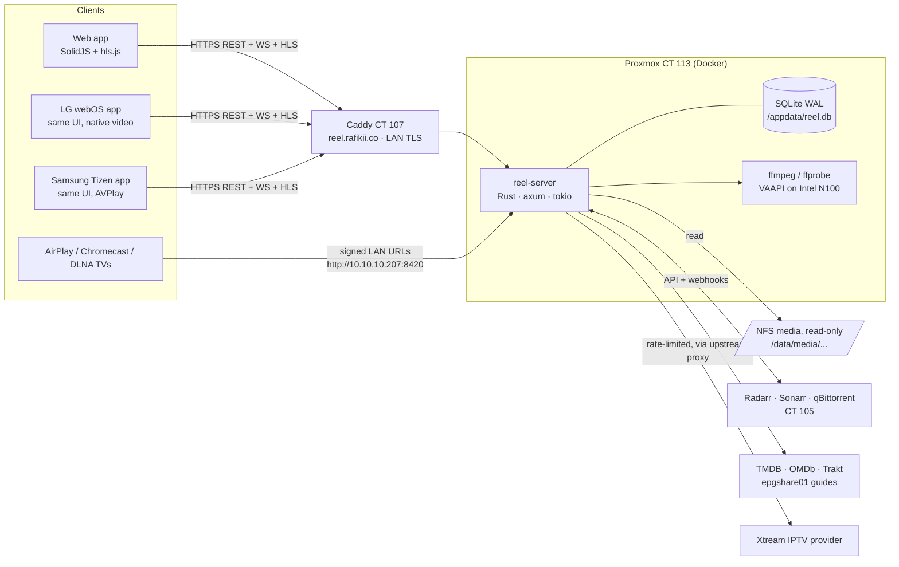
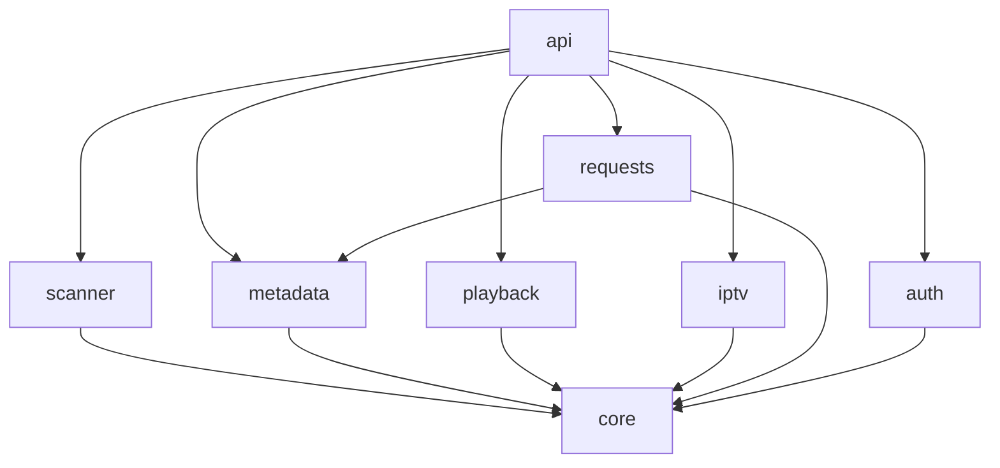
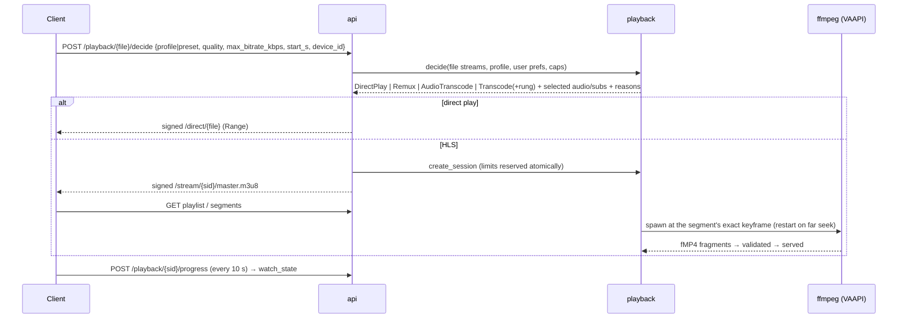
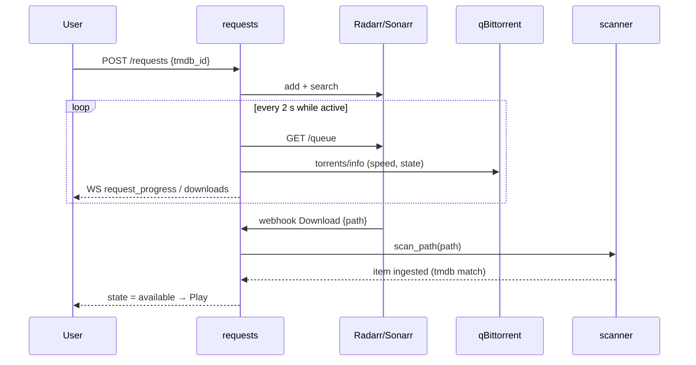

# Architecture

## 1. System overview



All of Reel runs as one process. Every client talks to it over one REST API (OpenAPI, 102 paths), one
WebSocket (`/api/v1/events`) for live updates, and HLS or byte-range HTTP for media.

## 2. Server: crate map

`server/` is a Cargo workspace (~62k lines of Rust, ~375 tests). Dependencies point downward, and `api` is
the only crate that knows about HTTP routes.



| Crate | Responsibility | Key ideas |
|---|---|---|
| `core` | Config (TOML + `REEL_*` env), SQLite pool + migrations (`migrations/0001…0015`), `ServerEvent` | Write transactions use `BEGIN IMMEDIATE`, which fixed SQLITE_BUSY_SNAPSHOT under concurrent scans |
| `scanner` | Filename parser, ffprobe ingest, incremental scan, rename detection, file watcher | Symlink-safe walk; local ffprobe restricted to the `file` protocol |
| `metadata` | TMDB client + matcher, local `.nfo`/art enricher, image cache | Local data beats TMDB; locked fields are never overwritten |
| `auth` | Users, sessions, invites, permissions, limits, Argon2, signing, audit | Signed URLs = HMAC(scope, user, exp, **sign_epoch**). Argon2 runs in bounded slots, and a failed attempt is recorded *before* verification |
| `playback` | Device profiles, decision engine, quality ladder, ffmpeg arg builder, session manager, keyframe index, segment validator, subtitles, upstream proxy | One ffmpeg per session; the playlist comes from the source's real keyframes; a global ffmpeg process budget; a scratch-disk budget |
| `iptv` | M3U/Xtream/XMLTV ingest, multi-guide EPG matching, channel hub (shared upstreams, GOP cache, connection budget), HLS packager, SSRF guard (`net.rs`), per-source politeness limiter | Newest stream wins for the same user; nothing is held warm when the plan allows only one connection |
| `requests` | Radarr/Sonarr clients, request workflow, download tracker, torrent adapters, webhooks, notifications, TMDB discovery | Polls the Arr queues every 2 s only while something is active; webhooks fill the gaps between polls |
| `api` | axum router, DTOs, OpenAPI (utoipa), WebSocket, static web app, cast/DLNA, VOD, browse/search/people/reviews | `AuthUser`/`AdminUser` extractors, plus permission checks on every route |

## 3. Key flows

### 3.1 Playing a library file



- **Decide.** The server picks the mode from the codecs and container, the subtitle type, HDR, and the bitrate
  cap, which is the minimum of the client's bandwidth hint, the user's limit and the profile. Above the cap it
  uses the ladder: 1080p at 8 Mbps, 720p at 4 Mbps, 480p at 2 Mbps.
- **Keyframe plans.** For copy and remux, the segment boundaries in the playlist are the source's real keyframes,
  read from the MKV Cues or MP4 `stss` index. Only when the file has no index does Reel run a background
  ffprobe, at low priority, and cache the result.
- **Segment safety.** A segment is served only once its boxes are complete and it belongs to the current
  ffmpeg run. The init segment stays the same across restarts.

### 3.2 Request → download → available



### 3.3 Live TV

```
provider ──(1 connection per channel, rate-limited)──► hub upstream task
     ├── MPEG-TS ring buffer + GOP cache (latest keyframe)
     ├── passthrough /iptv/live/{sid}/stream.ts   (TV native players, zero CPU)
     └── shared HLS packager (ffmpeg -c copy, or VAAPI transcode) → browsers
```

- **Budget.** A per-source connection budget enforces the provider's `max_connections`. If the same user tunes
  again, their older session is stopped first.
- **Guide.** Reel imports the provider's XMLTV (empty for this provider), then each external guide URL in
  priority order. Channels are matched by tvg-id first, then by name keys normalised for prefixes, quality
  tags, country suffixes, Arabic letter variants and so on. A channel takes its programmes from the first
  guide that actually has some for it.

### 3.4 IPTV VOD

The catalog (categories, streams, series) is imported during the source refresh. Details load lazily the first
time someone opens a title (`get_vod_info` / `get_series_info`) and are enriched with TMDB data when the
provider supplies an id. Playback goes through the same decision engine. ffmpeg reads the provider through a
**loopback upstream proxy** that holds the credentials, applies the SSRF policy and rewrites HLS manifests, so
provider URLs never show up in argv, logs or client responses.

## 4. Clients

```
clients/
├── packages/sdk   openapi-typescript types + fetch client + WS helper (ws tickets)
├── packages/ui    shared SolidJS components, PlayerAdapter (HlsJs / WebOS / AVPlay), device-profile
│                  detection (MSE probing incl. HEVC), platform layer (remote keys, server URL), progress store
└── apps/
    ├── web        the app (routes: Home, Movies/Shows (library · IPTV), Discover, Search, Person, Item,
    │              Player, Live TV + Guide, Requests, Downloads, Settings/Admin, Settings → Playback)
    ├── webos      packages apps/web (VITE_TARGET=tv, relative asset base) + appinfo.json
    └── tizen      same, with config.xml + AVPlay privileges
```

One UI codebase covers the browser, LG and Samsung. The differences are confined to a `PlayerAdapter` and a
platform layer. Web builds use absolute asset paths so deep links work, while TV packages use relative paths
because they load from `file://`.

## 5. Architecture choices (and why)

| # | Choice | Why | Trade-off accepted |
|---|---|---|---|
| A1 | **Rust (tokio + axum), single binary** | Many long-lived streams (IPTV fan-out, HLS) with predictable memory on a 4 GB LXC; no GC pauses; one deployable artifact | Slower to iterate than Go or TypeScript; heavy builds (~10 min cold in CI) |
| A2 | **ffmpeg/ffprobe as subprocesses, never linked** | No FFI or build fragility; an ffmpeg crash can't take down the server; HW backends come from the distro's ffmpeg | Process management, stderr parsing, argv hygiene (handled by the redactor and the upstream proxy) |
| A3 | **SQLite (WAL) instead of Postgres** | No extra service; plenty for a household plus friends; backups are one file | Single writer, so write transactions use `BEGIN IMMEDIATE` and a 30 s busy timeout |
| A4 | **Direct play first, HLS fMP4 otherwise, keyframe-indexed VOD playlists** | Most TV clients decode HEVC/HDR/AC3 natively. A VOD-style playlist allows seeking anywhere; keyframe-true boundaries keep remux segments valid | Restarts on far seeks; segment validation adds complexity |
| A5 | **Native keyframe index readers (MKV Cues / MP4 stss)** | A whole-file ffprobe over NFS took 13+ minutes; reading the index takes kilobytes | Needs an ffprobe fallback for files without an index |
| A6 | **Server-side quality ladder fed by a client bandwidth hint** | Remote viewers on slow links (measured 3.5 Mbps over a Tailscale relay); VAAPI on the N100 does 1080p→720p at ~8× realtime | A single rendition per session (no multi-variant ABR) to save GPU; quality changes happen by re-deciding |
| A7 | **One shared SolidJS UI for web, webOS and Tizen** | webOS and Tizen are web runtimes, so one codebase gives three platforms; Solid is fast on weak TV CPUs | Must target Chromium 68 (no heavy CSS effects) |
| A8 | **Built-in requests talking to Radarr/Sonarr** | One app instead of Plex + Seerr; progress rings tied straight to the queues | Coupled to the Arr v3 APIs |
| A9 | **Download progress from the Arr queue + optional torrent adapter** | The queue alone is enough for the ring; the torrent client adds speed, peers and stuck reasons | Two sources have to be reconciled (matched by infohash) |
| A10 | **IPTV hub: one upstream per channel, a GOP cache, a connection budget** | Providers limit connections (this plan allows 1); near-instant zapping; no duplicate bandwidth | Hub complexity; newest-wins policy for a single user |
| A11 | **Multi-guide EPG with name matching** | This provider ships no guide data; free per-country XMLTV files fill the gap | Name matching can mis-map a channel (manual override per channel is available) |
| A12 | **Signed, short-lived media URLs (HMAC + sign_epoch)** | TVs, Chromecast and native players can't send auth headers; the epoch makes URLs revocable | A URL is a bearer capability until it expires (1 h playback, 8 h cast) |
| A13 | **Opaque session tokens (hashed at rest), not JWT** | Instant revocation, small surface | Every request looks the token up in the DB (cached) |
| A14 | **Private by default, reached over Tailscale** | Unaudited new code; casting and IPTV are home-network features | Remote speed depends on the Tailscale path (now direct, 9–15 Mbps) |
| A15 | **Image build in GitHub Actions → GHCR (private) → pulled on CT 113** | The N100 doesn't spend time building; reproducible images; pull-only token on the server | ~10 min per server change (web-only changes take ~1 min thanks to layer caching) |
| A16 | **Internal upstream proxy for ffmpeg** | ffmpeg ignores the app's SSRF checks and puts credentials in argv; the proxy enforces both | One more hop for VOD reads |

## 6. Data model (essentials)

`users`, `user_limits`, `user_prefs`, `sessions_auth`, `invites`, `audit_log` · `libraries`, `library_access`,
`media_items` (movie/show/season/episode), `media_files`, `media_file_links`, `streams`, `people`, `credits`,
`genres`, `collections` · `watch_state`, `playback_sessions` · `requests`, `request_downloads`, `arr_servers`,
`download_clients`, `notification_targets` · `iptv_sources` (+ `epg_urls`), `channels`, `channel_aliases`,
`epg_programs`, `epg_channels`, `iptv_epg_sources`, `user_channel_favorites` · VOD catalog tables, `omdb_cache`.
Migrations are in `server/crates/core/migrations` and applied on startup.

## 7. Security model (summary)

- **Network.** Private on the LAN (Caddy `*.rafikii.co`, LAN-only) and over Tailscale. Not publicly exposed.
- **Authentication.**
  - Argon2id with bounded concurrency.
  - Lockout per (user, IP), with a /64 bucket for IPv6.
  - `/setup` only from the LAN or with a one-time token.
  - Sessions slide for 30 days, with a 90-day absolute limit.
  - WebSocket connections authenticate with short-lived tickets.
- **Authorization.**
  - Admin routes use the `AdminUser` extractor.
  - Library access is enforced on items, images, media and search.
  - Per-user flags gate IPTV, VOD, requests and casting.
  - Cast control is admin-only by default.
- **Media.**
  - Signed URLs carry an epoch.
  - The stream guard decodes the session id and checks the owner.
  - Playback errors are generic (diagnostics are redacted server-side).
- **Outbound.**
  - The SSRF guard applies at connect time, including DNS and redirects.
  - ffmpeg is mediated by the upstream proxy.
  - IPTV and guide ingestion have size budgets *(see STATUS for what's still open)*.
- **Container.** Non-root, `cap_drop: ALL`, read-only rootfs, read-only media, memory/PID/CPU limits. CT 113's
  Proxmox firewall blocks LAN egress apart from the Arr hosts and qBittorrent.
- A three-reviewer security council (2026-11-03) produced the hardening backlog; see
  [STATUS.md](STATUS.md#security-posture).
