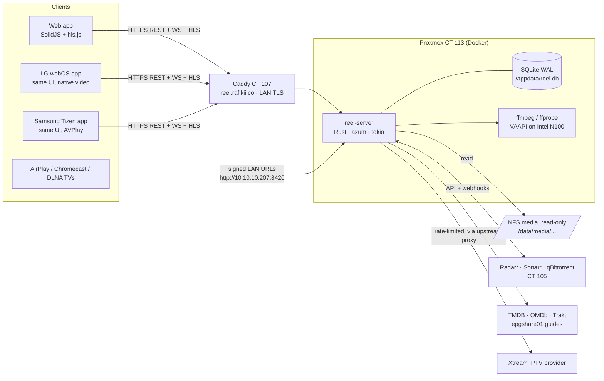
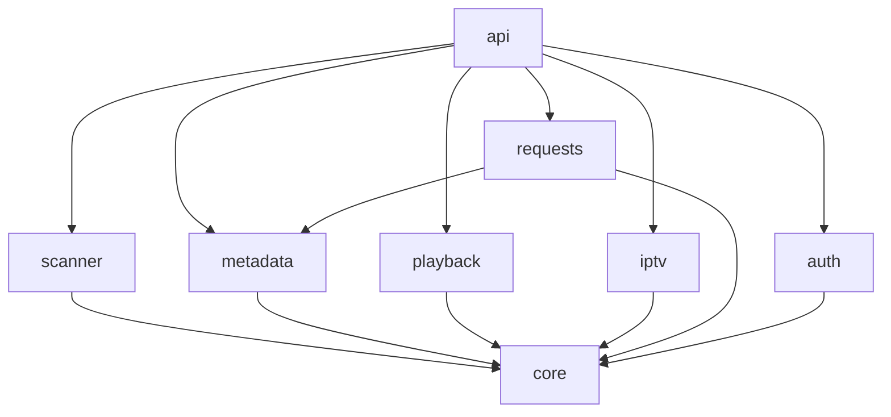
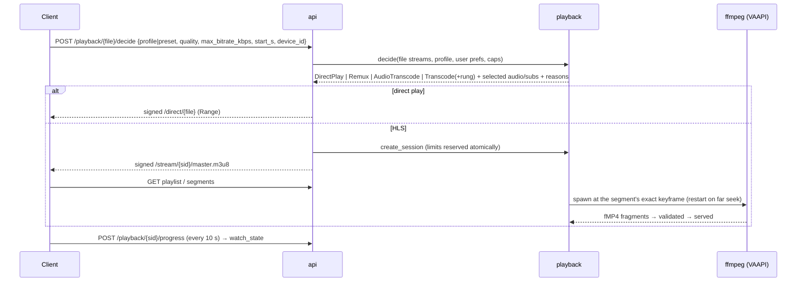
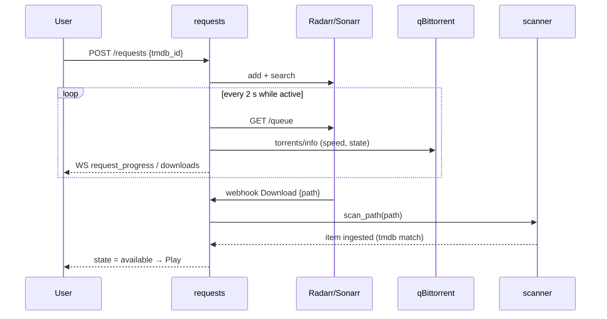

# Architecture

## 1. System overview



All of Reel runs as one process. Every client talks to it over one REST API (OpenAPI, 102 paths), one
WebSocket (`/api/v1/events`) for live updates, and HLS or byte-range HTTP for media.

## 2. Server: crate map

`server/` is a Cargo workspace (~62k lines of Rust, ~375 tests). Dependencies point downward, and `api` is
the only crate that knows about HTTP routes.



| Crate | Responsibility | Key ideas |
|---|---|---|
| `core` | Config (TOML + `REEL_*` env), SQLite pool + migrations (`migrations/0001…0015`), `ServerEvent` | Write transactions use `BEGIN IMMEDIATE`, which fixed SQLITE_BUSY_SNAPSHOT under concurrent scans |
| `scanner` | Filename parser, ffprobe ingest, incremental scan, rename detection, file watcher | Symlink-safe walk; local ffprobe restricted to the `file` protocol |
| `metadata` | TMDB client + matcher, local `.nfo`/art enricher, image cache | Local data beats TMDB; locked fields are never overwritten. Local artwork is only served after it resolves inside a library root and passes a magic-byte check (A19) |
| `auth` | Users, sessions, invites, permissions, limits, Argon2, signing, audit | Signed URLs = HMAC(scope, user, exp, **sign_epoch**). Argon2 runs in bounded slots, and a failed attempt is recorded *before* verification |
| `playback` | Device profiles, decision engine, quality ladder, ffmpeg arg builder, session manager, keyframe index, segment validator, subtitles, upstream proxy | One ffmpeg per session; the playlist comes from the source's real keyframes; a global ffmpeg process budget; a scratch-disk budget |
| `iptv` | M3U/Xtream/XMLTV ingest, multi-guide EPG matching, channel hub (shared upstreams, GOP cache, connection budget), HLS packager, SSRF guard (`net.rs`), per-source politeness limiter | Newest stream wins for the same user; nothing is held warm when the plan allows only one connection |
| `requests` | Radarr/Sonarr clients, request workflow, download tracker, torrent adapters, webhooks, notifications, TMDB discovery | Polls the Arr queues every 2 s only while something is active; webhooks fill the gaps between polls |
| `api` | axum router, DTOs, OpenAPI (utoipa), WebSocket, static web app, cast/DLNA, VOD, browse/search/people/reviews | `AuthUser`/`AdminUser` extractors, plus permission checks on every route |

## 3. Key flows

### 3.1 Playing a library file



- **Decide.** The server picks the mode from the codecs and container, the subtitle type, HDR, and the bitrate
  cap, which is the minimum of the client's bandwidth hint, the user's limit and the profile. Above the cap it
  uses the ladder: 1080p at 8 Mbps, 720p at 4 Mbps, 480p at 2 Mbps.
- **Keyframe plans.** For copy and remux, the segment boundaries in the playlist are the source's real keyframes,
  read from the MKV Cues or MP4 `stss` index. Only when the file has no index does Reel run a background
  ffprobe, at low priority, and cache the result.
- **Segment safety.** A segment is served only once its boxes are complete and it belongs to the current
  ffmpeg run. The init segment stays the same across restarts.

### 3.2 Request → download → available



### 3.3 Live TV

```
provider ──(1 connection per channel, rate-limited)──► hub upstream task
     ├── MPEG-TS ring buffer + GOP cache (latest keyframe)
     ├── passthrough /iptv/live/{sid}/stream.ts   (TV native players, zero CPU)
     └── shared HLS packager (ffmpeg -c copy, or VAAPI transcode) → browsers

provider HLS (.m3u8) ──► upstream proxy (127.0.0.1, guarded client) ──► ffmpeg -c copy → MPEG-TS ──► hub

provider ──(the device opens its own connection)──► device      mode "direct" (opt-in)
     Reel holds only the budget slot (an `ExternalSlot`) and expects a heartbeat
```

- **Direct mode.** With `REEL_ALLOW_DIRECT_LIVE`, `POST /iptv/channels/{id}/tune {"mode":"direct"}` claims a
  provider slot under the usual policy (own sessions: newest wins; others: 429; admins: takeover) and returns the
  provider URL instead of a signed Reel URL. It never shares a hub pipe, because a second viewer on the same
  channel would be a second provider connection. The device calls `POST /iptv/sessions/{id}/keepalive` every 15 s;
  after about 30 s of silence (or `DELETE /iptv/sessions/{id}`) the session ends and the slot returns. The provider
  URL is never serialized in session lists and the tune is audited (`iptv_direct`).

- **HLS upstreams.** A channel whose provider URL is HLS (`.m3u8` path or an `mpegurl` content type) is remuxed
  to MPEG-TS by ffmpeg before it enters the hub. ffmpeg gets only a lease on the hub's own loopback upstream
  proxy (`http://127.0.0.1:{port}/internal/upstream/{token}/f.m3u8`, protocols `http,tcp,crypto`). The proxy
  sends the source's user agent and referrer, applies the SSRF policy to every playlist, segment and key, and
  rewrites each nested URI to a token. Live leases use a sliding expiry (120 s after last use), a reloaded
  playlist maps the same segment to the same token, and a redirected playlist is reloaded from its redirect
  target the way a player would. Dropping the connection kills ffmpeg and revokes every token of the lease.
  Raw MPEG-TS channels are read by the hub's guarded HTTP client directly; direct mode bypasses the hub.
- **Budget.** A per-source connection budget enforces the provider's `max_connections`. If the same user tunes
  again, their older session is stopped first.
- **Guide.** Reel imports the provider's XMLTV (empty for this provider), then each external guide URL in
  priority order. Channels are matched by tvg-id first, then by name keys normalised for prefixes, quality
  tags, country suffixes, Arabic letter variants and so on. A channel takes its programmes from the first
  guide that actually has some for it.

### 3.4 IPTV VOD

The catalog (categories, streams, series) is imported during the source refresh. Details load lazily the first
time someone opens a title (`get_vod_info` / `get_series_info`) and are enriched with TMDB data when the
provider supplies an id. Playback goes through the same decision engine. ffmpeg reads the provider through a
**loopback upstream proxy** that holds the credentials, applies the SSRF policy and rewrites HLS manifests, so
provider URLs never show up in argv, logs or client responses. Direct play is proxied by `/vod/direct` (with
`Range`). Every VOD request uses the source's configured User-Agent. A VOD playback holds one slot of the
provider's connection budget (shared with live TV); when the session ends (stop, takeover, idle reap), its
in-flight direct-play responses are cut by a per-session stop signal, so a paused client can't keep the
provider connection open. ffmpeg's input is registered **exclusive** in the proxy: one provider connection per
session, newest request wins (A26). A VOD remux (video copy) gets the same keyframe-true VOD playlist as a
library remux: the keyframe index is read from the container metadata (MKV Cues / MP4 `stss`) with a few
`Range` requests through that same exclusive token before ffmpeg starts, and cached per title (A27). A seek
restarts ffmpeg with `-ss` at the target keyframe. Without a readable index (no `Range` support, a container
without one, a limit hit) the session falls back to ffmpeg's growing EVENT playlist, which players treat as live
and can't seek in.

## 4. Clients

```
clients/
├── packages/sdk   openapi-typescript types + fetch client + WS helper (ws tickets)
├── packages/ui    shared SolidJS components, PlayerAdapter (HlsJs / WebOS / AVPlay), device-profile
│                  detection (MSE probing incl. HEVC), platform layer (remote keys, server URL), progress store
└── apps/
    ├── web        the app (routes: Home, Movies/Shows (library · IPTV), Discover, Search, Person, Item,
    │              Player, Live TV + Guide, Requests, Downloads, Settings/Admin, Settings → Playback)
    ├── webos      packages apps/web (VITE_TARGET=tv, relative asset base) + appinfo.json
    └── tizen      same, with config.xml + AVPlay privileges
```

One UI codebase covers the browser, LG and Samsung. The differences are confined to a `PlayerAdapter` and a
platform layer. Web builds use absolute asset paths so deep links work, while TV packages use relative paths
because they load from `file://`.

## 5. Architecture choices (and why)

| # | Choice | Why | Trade-off accepted |
|---|---|---|---|
| A1 | **Rust (tokio + axum), single binary** | Many long-lived streams (IPTV fan-out, HLS) with predictable memory on a 4 GB LXC; no GC pauses; one deployable artifact | Slower to iterate than Go or TypeScript; heavy builds (~10 min cold in CI) |
| A2 | **ffmpeg/ffprobe as subprocesses, never linked** | No FFI or build fragility; an ffmpeg crash can't take down the server; HW backends come from the distro's ffmpeg | Process management, stderr parsing, argv hygiene (handled by the redactor and the upstream proxy) |
| A3 | **SQLite (WAL) instead of Postgres** | No extra service; plenty for a household plus friends; backups are one file | Single writer, so write transactions use `BEGIN IMMEDIATE` and a 30 s busy timeout |
| A4 | **Direct play first, HLS fMP4 otherwise, keyframe-indexed VOD playlists** | Most TV clients decode HEVC/HDR/AC3 natively. A VOD-style playlist allows seeking anywhere; keyframe-true boundaries keep remux segments valid | Restarts on far seeks; segment validation adds complexity |
| A5 | **Native keyframe index readers (MKV Cues / MP4 stss)** | A whole-file ffprobe over NFS took 13+ minutes; reading the index takes kilobytes | Needs an ffprobe fallback for files without an index |
| A6 | **Server-side quality ladder fed by a client bandwidth hint** | Remote viewers on slow links (measured 3.5 Mbps over a Tailscale relay); VAAPI on the N100 does 1080p→720p at ~8× realtime | A single rendition per session (no multi-variant ABR) to save GPU; quality changes happen by re-deciding |
| A7 | **One shared SolidJS UI for web, webOS and Tizen** | webOS and Tizen are web runtimes, so one codebase gives three platforms; Solid is fast on weak TV CPUs | Must target Chromium 68 (no heavy CSS effects) |
| A8 | **Built-in requests talking to Radarr/Sonarr** | One app instead of Plex + Seerr; progress rings tied straight to the queues | Coupled to the Arr v3 APIs |
| A9 | **Download progress from the Arr queue + optional torrent adapter** | The queue alone is enough for the ring; the torrent client adds speed, peers and stuck reasons | Two sources have to be reconciled (matched by infohash) |
| A10 | **IPTV hub: one upstream per channel, a GOP cache, a connection budget** | Providers limit connections (this plan allows 1); near-instant zapping; no duplicate bandwidth | Hub complexity; newest-wins policy for a single user |
| A11 | **Multi-guide EPG with name matching** | This provider ships no guide data; free per-country XMLTV files fill the gap | Name matching can mis-map a channel (manual override per channel is available) |
| A12 | **Signed, short-lived media URLs (HMAC + sign_epoch)** | TVs, Chromecast and native players can't send auth headers; the epoch makes URLs revocable | A URL is a bearer capability until it expires (1 h playback, 8 h cast) |
| A13 | **Opaque session tokens (hashed at rest), not JWT** | Instant revocation, small surface | Every request looks the token up in the DB (cached) |
| A14 | **Private by default, reached over Tailscale** | Unaudited new code; casting and IPTV are home-network features | Remote speed depends on the Tailscale path (now direct, 9–15 Mbps) |
| A15 | **Image build in GitHub Actions → GHCR (private) → pulled on CT 113** | The N100 doesn't spend time building; reproducible images; pull-only token on the server | ~10 min per server change (web-only changes take ~1 min thanks to layer caching) |
| A16 | **Internal upstream proxy for ffmpeg** (VOD, remote probes/subtitles and live HLS upstreams) | ffmpeg ignores the app's SSRF checks and puts credentials in argv; the proxy enforces both | One more hop for VOD reads and live HLS segments |
| A18 | **Deploy from GitHub via a self-hosted runner on the LAN, gated by a manual "Run workflow"** | GitHub can't reach CT 113 and there are no inbound ports; the runner only connects outbound. The click is the gate (works on any GitHub plan; no surprise restarts mid-movie); full audit trail in Actions; tickets move to Deployed in the same job | One more CT to maintain. The runner holds a deploy key (pinned on minix to a two-verb forced command) and a PAT with `repo`+`project`. The repo must stay private |
| A19 | **Local artwork is confined at serve time, not at scan time** | A poster that is a symlink (`poster.jpg -> signing.key`) was streamed raw. The image route now canonicalizes the `file://` path (symlinks and `..` resolved), requires it to sit under a `libraries.paths_json` root, caps the size (32 MB) and sniffs JPEG/PNG/WebP magic bytes. Checking on every request also covers rows written before the fix and symlinks swapped in after a scan. `ImageCache::get` refuses `file://` outright; only `get_in` with roots allows it | One extra `canonicalize` + 12-byte read per uncached request. A library whose `paths_json` is empty or stale gets no local artwork (404) |
| A20 | **Direct Live TV playback is opt-in per server (`REEL_ALLOW_DIRECT_LIVE`) and per device, and still counts against the connection budget** | Saves server CPU/bandwidth and can be faster on slow remote paths; some players do better against the provider than against Reel's relay | The provider URL carries the provider login, so it reaches the device, which breaks the "credentials never leave the server" rule for anyone who turns this on. Reel can't see the stream, so it relies on a heartbeat. No GOP cache or shared upstream, so zapping is slower. Browsers mostly can't play it (falls back to the server) |
| A21 | **Fixed ingestion budgets for playlists, guides and the Xtream API (`iptv::limits`), as constants, set several times above the real provider** | The bytes come from a third party: a broken or hostile provider/guide host could stream forever, send a gzip bomb, one endless XML text node or M3U line (quick-xml and the line splitter buffer a whole token), or millions of records, and exhaust the 3 GB container or a worker. Caps: playlist 512 MiB / 10 min, M3U line 64 KiB, 500k channels; Xtream answer 256 MiB / 120 s, 500k VOD items, 50k categories; guide download 1 GiB / 20 min, 4 GiB after gunzip, XML event 1 MiB, attribute 8 KiB (longer ignored), text 16 KiB (truncated), 200k guide channels, 20M programmes. The real provider is ~41k movies, ~15k series and a few hundred MB of guide. Downloaded guides are a drop-guard temp file, so every error path deletes them | Hitting a cap fails that refresh (the error is recorded on the source/guide; the previous channels, guide and catalog stay). Changing a limit needs a rebuild, not an env var. Long descriptions are cut at 16 KiB |
| A22 | **sqlx is built with SQLite only, from one workspace entry; `cargo audit` exceptions live in `server/.cargo/audit.toml` with a reason** | No MySQL/Postgres driver code (or its `rsa` dependency, RUSTSEC-2023-0071) in the binary. One declaration means no crate can quietly turn default features back on. A CI step fails if `sqlx-mysql`, `sqlx-postgres` or `rsa` enter the build graph | `Cargo.lock` still lists `sqlx-mysql`/`rsa` (cargo records disabled optional deps, rust-lang/cargo#10801), so the audit needs one documented ignore until sqlx 0.9 (rustc 1.94) |
| A23 | **XML text is collected per element and trimmed at its end tag, not by the reader** | quick-xml ≥ 0.38 reports `&amp;`/`&#233;` as separate events; the reader's `trim_text` would eat the spaces around them ("News &amp; Weather" → "News&Weather"). Predefined and character references are resolved by Reel | Unknown named entities (no DTD support) are kept verbatim (`&nbsp;`) instead of failing the whole guide import |
| A24 | **Live HLS upstreams use the upstream proxy with sliding, lease-scoped tokens** (#11) | Before, the hub gave ffmpeg the provider URL: the login sat in argv and `/proc`, and ffmpeg fetched segments and redirects with no SSRF check. A live playlist is reloaded every few seconds, so fixed-expiry tokens would expire mid-stream and fresh tokens per reload would fill the token map; reusing a token per (lease, URL) and expiring it 120 s after last use keeps the map bounded. Reloading from the redirect target matches what ffmpeg did itself, so the provider doesn't see a new login per reload | One more loopback hop per segment. The proxy has no politeness gate of its own (the hub paces the connect, ffmpeg does the reloads). A provider whose redirect target expires makes ffmpeg fail and the hub reconnect, as before |
| A25 | **A VOD direct-play response lives only as long as its playback session** | On a one-connection provider, a paused or abandoned browser tab would otherwise hold the provider connection after a takeover or stop, and the new viewer would get HTTP 46x | A task per direct-play response pumps the provider body; a long `bytes=0-` stream is cut once the session is idle-reaped (the web player keeps it alive with progress reports) |
| A26 | **A session's ffmpeg input holds at most one provider connection: in the proxy, a new request cuts the previous one and waits for it to close (`UpstreamOpts::exclusive`)** | ffmpeg's HTTP seek opens the new connection before closing the old one ("if it fails, continue on old connection"), so each seek briefly needed two connections, which a one-connection provider refuses (HTTP 46x) | A seek that has to cut an open connection waits ~100 ms longer. If the new request fails, ffmpeg's fallback to the old connection finds it cut and reconnects. Only for single-reader inputs: HLS tokens (renditions load in parallel), probe/subtitle leases and browser direct play aren't exclusive |
| A27 | **Remote remux reads the keyframe index from the container over `Range` (#92)** | Remote copy sessions used to skip the index (a full scan would download the file), so they served ffmpeg's EVENT playlist without ENDLIST. hls.js treats that as live (`duration = Infinity`, nothing seekable), so IPTV VOD remux could not be seeked at all. The MKV Cues / MP4 `stss` readers (A5) only need the head and the index, so a buffered `Range` reader (1 MiB blocks, at most 12 requests / 24 MiB / 8 s, `206` required) reads them through the session's exclusive proxy token, one request at a time, before ffmpeg opens the input. The index is cached under `keyframes/{file}-remote-{sha256(url)[..8]}.json` (no URL or login in the name) and only reused if it still covers the probed duration | Starting a remote remux makes 2–4 extra provider requests the first time (none once cached) and waits for them. A provider that changes a file without changing its URL or duration gets a stale index until the cache is cleared. Containers without an index (TS, AVI) or a provider without `Range` still get the unseekable EVENT playlist |

## 6. Data model (essentials)

`users`, `user_limits`, `user_prefs`, `sessions_auth`, `invites`, `audit_log` · `libraries`, `library_access`,
`media_items` (movie/show/season/episode), `media_files`, `media_file_links`, `streams`, `people`, `credits`,
`genres`, `collections` · `watch_state`, `playback_sessions` · `requests`, `request_downloads`, `arr_servers`,
`download_clients`, `notification_targets` · `iptv_sources` (+ `epg_urls`), `channels`, `channel_aliases`,
`epg_programs`, `epg_channels`, `iptv_epg_sources`, `user_channel_favorites` · VOD catalog tables, `omdb_cache`.
Migrations are in `server/crates/core/migrations` and applied on startup.

## 7. Security model (summary)

- **Network.** Private on the LAN (Caddy `*.rafikii.co`, LAN-only) and over Tailscale. Not publicly exposed.
- **Authentication.**
  - Argon2id with bounded concurrency.
  - Lockout per (user, IP), with a /64 bucket for IPv6.
  - `/setup` only from the LAN or with a one-time token.
  - Sessions slide for 30 days, with a 90-day absolute limit.
  - WebSocket connections authenticate with short-lived tickets.
- **Authorization.**
  - Admin routes use the `AdminUser` extractor.
  - Library access is enforced on items, images, media and search.
  - Per-user flags gate IPTV, VOD, requests and casting.
  - Cast control is admin-only by default.
- **Media.**
  - Signed URLs carry an epoch.
  - The stream guard decodes the session id and checks the owner.
  - Playback errors are generic (diagnostics are redacted server-side).
- **Outbound.**
  - The SSRF guard applies at connect time, including DNS and redirects. IPv6 forms that carry an IPv4
    address (mapped, translated, NAT64, 6to4, Teredo) are judged by that IPv4 address; IPv4-compatible
    `::a.b.c.d` is refused. Redirects don't send the previous URL as `Referer` (it can hold the provider login).
  - ffmpeg is mediated by the upstream proxy: VOD, remote probes and subtitles, and live HLS upstreams. No
    ffmpeg command line holds a provider URL or credential.
  - IPTV and guide ingestion have byte, time, size and count budgets (A21).
- **Container.** Non-root, `cap_drop: ALL`, read-only rootfs, read-only media, memory/PID/CPU limits. CT 113's
  Proxmox firewall blocks LAN egress apart from the Arr hosts and qBittorrent.
- A three-reviewer security council (2026-11-03) produced the hardening backlog; see
  [STATUS.md](STATUS.md#security-posture).
